<picture><source media="(max-width: 600px) and (prefers-color-scheme: dark)" srcset="assets/header-m-dark.svg"><source media="(max-width: 600px)" srcset="assets/header-m-light.svg"><source media="(prefers-color-scheme: dark)" srcset="assets/header-dark.svg"></picture>

AI agent systems engineer and technical founder. I have spent the past year on agentic systems and harness engineering, starting while I was finishing high school, where I was also wrestling team captain for two years. For most of that stretch I worked 13 to 14 hours a day on it, around school, my job and wrestling. I work across several harnesses instead of just one: OpenCode and DeepSeek Harness, Claude Desktop and Claude Code, Gemini Antigravity, and ChatGPT Codex — picking whichever fits the job and has capacity. My flagship cross-platform single-binary Rust desktop and web apps (Linux, macOS, and Windows <code>.exe</code> with chromeless desktop launch) are built on one shared House Frontend system (Geist + Geist Mono, calm nested hairline surfaces, Cmd+K navigation, light and dark themes inside Settings): <b>OpenRO</b> (<code>v1.1.0</code>) is a <b>Studio Copilot 3-pane Roblox Studio AI IDE</b> with <code>Agent | Plan | Ask</code> modes and reviewable unified Luau diffs, a <b>Monetization &amp; Retention Luau pack</b> (<code>ProcessReceipt</code> idempotency, GamePass, Daily Streak), directly embedded live Roblox Studio + auto-synced Explorer, the <code>OpenRoCompanion.lua</code> Studio plugin, all 13 official MCP tools, Co-Building Studio 3D, Rojo Ship Pack (<code>.zip</code>) + <code>.rbxlx</code> XML, Tool &amp; Skill Library, Market Taste Craft Radar, and Blender/WAV synthesis; <b>OpenBell</b> (<code>v0.9.0</code>) is an <b>Institutional Quant Terminal</b> for Kalshi Trade API v2 with a 1-click <b>Full Quant Edge Audit</b> 5-stage Go/No-Go funnel + causal lookahead-canary tests, fail-closed Hard Risk Rails (disarmed by default on every boot), an Emergency Kill Switch, Out-of-Sample Strategy Tournament, PAV isotonic calibration, and a $500/day capital scaling planner; and <b>Fleet</b> (<code>v0.9.0</code>) is a <b>Codex/Linear parallel coding-agent workbench</b> (<code>opencode</code>, <code>Claude Code</code>, <code>Codex</code>, <code>-24.1%</code> bundle) with a Goal-to-DAG planner, interactive multi-wave Board / DAG Graph toggle, confirmation-gated PR Preview, Worktree Inspector, Daily Dispatch Budget guardrails, autonomous Auto-Heal, and Playbooks — alongside <b>Ergon</b> (<code>v0.10.0</code>), a <b>Claude-Desktop employee agent desk</b> with a unified responsive SPA (<code>-47.8%</code> vs v0.9.0, <code>2.19 MB → 1.15 MB</code>), inline approval/diff cards, background cadence scheduler, automatic <code>.history/</code> version diff &amp; restore, tamper-evident Field-Book audit bundles, 3-company switcher, and 12 built-in workflows. Interactive résumé, OpenMotion walkthroughs &amp; live browser apps: <a href="https://cayleb-james2008.github.io/">cayleb-james2008.github.io</a>.

<picture><source media="(max-width: 600px) and (prefers-color-scheme: dark)" srcset="assets/now-m-dark.svg"><source media="(max-width: 600px)" srcset="assets/now-m-light.svg"><source media="(prefers-color-scheme: dark)" srcset="assets/now-dark.svg"></picture>

<h3><picture><source media="(max-width: 600px) and (prefers-color-scheme: dark)" srcset="assets/section-1-m-dark.svg"><source media="(max-width: 600px)" srcset="assets/section-1-m-light.svg"><source media="(prefers-color-scheme: dark)" srcset="assets/section-1-dark.svg"></picture></h3>

<picture><source media="(max-width: 600px) and (prefers-color-scheme: dark)" srcset="assets/work-roblox-m-dark.svg"><source media="(max-width: 600px)" srcset="assets/work-roblox-m-light.svg"><source media="(prefers-color-scheme: dark)" srcset="assets/work-roblox-dark.svg"></picture><picture><source media="(max-width: 600px) and (prefers-color-scheme: dark)" srcset="assets/work-openbell-m-dark.svg"><source media="(max-width: 600px)" srcset="assets/work-openbell-m-light.svg"><source media="(prefers-color-scheme: dark)" srcset="assets/work-openbell-dark.svg"></picture><picture><source media="(max-width: 600px) and (prefers-color-scheme: dark)" srcset="assets/work-fleet-m-dark.svg"><source media="(max-width: 600px)" srcset="assets/work-fleet-m-light.svg"><source media="(prefers-color-scheme: dark)" srcset="assets/work-fleet-dark.svg"></picture><picture><source media="(max-width: 600px) and (prefers-color-scheme: dark)" srcset="assets/work-ergon-m-dark.svg"><source media="(max-width: 600px)" srcset="assets/work-ergon-m-light.svg"><source media="(prefers-color-scheme: dark)" srcset="assets/work-ergon-dark.svg"></picture>

### OpenRO — Studio Copilot 3-pane Roblox Studio AI IDE (`v1.1.0`)

**Code:** [github.com/cayleb-james2008/open-ro](https://github.com/cayleb-james2008/open-ro) · **Release:** [v1.1.0 (Linux / macOS / Windows `.exe`)](https://github.com/cayleb-james2008/open-ro/releases/tag/v1.1.0) · **Product page:** [cayleb-james2008.github.io/projects/openro.html](https://cayleb-james2008.github.io/projects/openro.html) · **Live web app:** [cayleb-james2008.github.io/demos/open-ro/](https://cayleb-james2008.github.io/demos/open-ro/)

- Cross-platform single-binary Rust desktop and web app (`v1.1.0`, `data-world="studio"`, chromeless `--app` launch): unobstructed **Studio Copilot 3-pane IDE** (`Explorer/Chats` left dock, `Embedded Studio | Studio 3D | Code & Diff | Playable Stage` center workspace + collapsible `Output Console | Agent Trace | Studio MCP Tools (13) | Properties` bottom drawer, and `Agent | Plan | Ask` Copilot right pane with custom `write_luau` / `multi_edit` and reviewable green/red unified Luau diffs), **Monetization & Retention Luau pack** (`ProcessReceipt` idempotency, GamePass, Daily Streak), **Directly Embedded Live Roblox Studio** + transparent official Studio MCP translation, zero-error **`OpenRoCompanion.lua` Studio plugin** (256-bit `0600` token), **Tool & Skill Library**, **Market Taste Craft Radar**, headless **Blender 3D `.obj`** + pure-Rust **PCM16 `.wav`** synthesis, and **Rojo Ship Pack (`.zip`)** + bidirectional `.rbxlx` XML.
- **Cold Verification (`298/298` Rust tests, `0` clippy / Windows `xwin` errors, `sloplint 0 FAIL`):** Verified at `92e528e5` across `1440×900`, `1280×800`, and `390×844` Light & Dark (`56/56` gate, `9/9` replay, `0` console errors) and offline `web-dist` with `0` external requests.
- Cold scale & security audit (`19.58 MB` release binary): **875 req/s** (`874.89 req/s`), **141.7 ms p95** (`141.69 ms`), `13.61 ms` cold boot, `45.52 MB` peak RSS, `10/10` (`100.0%`) Dual-SSE survival, and **`43/43`** adversarial raw-TCP/HTTP security fuzz vectors blocked cleanly (`0` 500s).

### OpenBell — Institutional Kalshi v2 Quant Terminal (`v0.9.0`)

**Code:** [github.com/cayleb-james2008/openbell](https://github.com/cayleb-james2008/openbell) · **Release:** [v0.9.0 (Linux / macOS / Windows `.exe`)](https://github.com/cayleb-james2008/openbell/releases/tag/v0.9.0) · **Product page:** [cayleb-james2008.github.io/projects/openbell.html](https://cayleb-james2008.github.io/projects/openbell.html) · **Live web sandbox:** [cayleb-james2008.github.io/demos/openbell/](https://cayleb-james2008.github.io/demos/openbell/)

- Cross-platform single-binary Rust **Institutional Quant Terminal** (`v0.9.0`, `data-world="terminal"`, chromeless `--app` launch): **1-click Full Quant Edge Audit** 5-stage Go/No-Go funnel + causal lookahead-canary tests, **Live Connected Kalshi Trade API v2** (RSA-PSS SHA-256 request signing, `0600` key storage, Demo & Production venues) strictly gated behind **Fail-Closed Hard Risk Rails** (`live_armed: false` on every boot/restart, explicit `confirm_arm`, per-order contract/dollar caps, daily loss cap, open-exposure cap, ticker-prefix allowlist, loopback + `X-OpenBell-CSRF` enforcement), and a one-click **Emergency Kill Switch** (`disarm + cancel_all`).
- Full quantitative research workbench alongside the live rails: Out-of-Sample **Strategy Tournament** + `12×12` Correlation & `5×4` Regime Heatmaps, **PAV Isotonic Recalibration** (60% IS / 40% OOS, Wilson CIs, Brier/ECE), **`$500/Day` Capital Scaling & Liquidity Capacity Engine** (1,000-path Monte Carlo compounding + 5-gate scorecard), 4-slot paper compounding desk, and toggleable Auto-Collector (`Off` / `60s` / `180s`). The browser sandbox runs 100% client-side offline on synthetic 15m data with zero real keys or private trading data.
- Cold scale & security audit (`13.44 MB` release binary, `108/108` Rust tests incl. causal lookahead-canary & CWE-59 symlink tests, `0` clippy / Windows errors): **1,178 req/s** (`1,177.51 req/s`), **112.9 ms p95** (`112.85 ms`), `2.61 ms` cold boot, `311.48 MB` peak RSS, `8/8` (`100.0%`) SSE survival, and **`49/49`** security & risk-rail fuzz checks pass (`101/101` UI gate, `18/18` replay, `sloplint 0 FAIL`).

### Fleet — Codex/Linear Parallel Agent Workbench (`v0.9.0`)

**Code:** [github.com/cayleb-james2008/fleet](https://github.com/cayleb-james2008/fleet) · **Release:** [v0.9.0 (Linux / macOS / Windows `.exe`)](https://github.com/cayleb-james2008/fleet/releases/tag/v0.9.0) · **Product page:** [cayleb-james2008.github.io/projects/fleet.html](https://cayleb-james2008.github.io/projects/fleet.html) · **Live web app:** [cayleb-james2008.github.io/demos/fleet/](https://cayleb-james2008.github.io/demos/fleet/)

- Cross-platform single-binary Rust desktop and web app (`v0.9.0`, `data-world="codex"`, `-24.1%` bundle, native Windows engine + chromeless `--app` launch): **Goal-to-DAG planner**, interactive multi-wave **`Board` / `DAG Graph` toggle**, **PR Preview & confirmation-gated GitHub PR creator**, **Worktrees Inspector** with safe non-main orphan pruning, **Daily Dispatch Budget guardrails** (`429` on cap), **Autonomous Auto-Heal** (ANSI-stripped stderr steering with SHA-256 identical-error loop guard), reusable **Playbook Templates**, and live **Board Telemetry**.
- **Cold Verification (`117/117` Rust tests, `0` clippy / Windows errors):** Verified at `cdfa84d5` with DAG cycle `400`, main-repo & traversal worktree delete `403`, confirmation-gated PR `400`, `52/52` UI gate, `6/6` replay, `sloplint 0 FAIL`, and standalone live-web bundle (`1,002 kB`, `30/30` `test-live-web.mjs` with `0` external requests).
- Cold scale & security audit (`11.14 MB` release binary): **2,456 req/s** (`2,456.29 req/s`), **30.2 ms p95** (`30.20 ms`), `43.56 ms` cold boot, `105.70 MB` peak RSS, `8/8` (`100.0%`) SSE survival, and **`19/19`** security fuzz checks pass.

### Ergon — Claude-Desktop Employee Agent Desk (`v0.10.0`)

**Code:** [github.com/cayleb-james2008/ergon](https://github.com/cayleb-james2008/ergon) · **Release:** [v0.10.0 (Linux / macOS / Windows `.exe`)](https://github.com/cayleb-james2008/ergon/releases/tag/v0.10.0) · **Product page:** [cayleb-james2008.github.io/projects/ergon.html](https://cayleb-james2008.github.io/projects/ergon.html) · **Live web app:** [cayleb-james2008.github.io/demos/ergon/](https://cayleb-james2008.github.io/demos/ergon/)

- Cross-platform single-binary Rust desktop and web app (`v0.10.0`, `data-world="claude"`, chromeless `--app` launch): **unified responsive SPA** (`-47.8%` vs v0.9.0, `2.19 MB → 1.15 MB`), **inline approval & diff cards**, collapsible `Cmd/Ctrl+I` Workspace Inspector, background **cadence routine scheduler** (`Pause/Resume`, UTC wall-clock, Run History), automatic **`.history/` file version history** with unified diff & one-click `Restore version`, **tamper-evident Field-Book Audit Bundle export**, 3-company workspace switcher, 12 built-in workflows, live SSE run streaming, Global `Cmd+K`, and SHA-256 receipts.
- **Cold Verification (`204/204` Rust tests, `0` clippy / Windows `xwin` errors):** Verified at `f0ee7c3a` (`74/74` UI gate, `6/6` Work Graph, `20/20` replay, `sloplint 0 FAIL`, `ergon-web.html` standalone `0` third-party requests, Host/CSRF/CL+TE/`413`/CWE-22/CWE-59/ZIP-slip clean).
- Cold scale & security audit (`16.63 MB` release binary): **724 req/s** (`723.60 req/s`), **188.7 ms p95** (`188.72 ms`), `12.44 ms` cold boot, `599.25 MB` peak RSS, `8/8` (`100.0%`) SSE survival, and **`38/38`** security fuzz vectors blocked cleanly (`0` 500s). In development; not yet installed at a customer company.

<h3><picture><source media="(max-width: 600px) and (prefers-color-scheme: dark)" srcset="assets/section-2-m-dark.svg"><source media="(max-width: 600px)" srcset="assets/section-2-m-light.svg"><source media="(prefers-color-scheme: dark)" srcset="assets/section-2-dark.svg"></picture></h3>

Active public repositories — the four cross-platform single-binary Rust desktop &amp; web apps (v0.9.0–v1.1.0), Sophos, and the interactive résumé site + live multi-document <a href="https://cayleb-james2008.github.io/lab/">/lab/</a> audit workbench (archived earlier work: <a href="https://github.com/cayleb-james2008/dotz">dotz</a> and <a href="https://github.com/cayleb-james2008/industry-ai-suite">industry-ai-suite</a>).

<a href="https://github.com/cayleb-james2008/open-ro"><picture><source media="(max-width: 600px) and (prefers-color-scheme: dark)" srcset="assets/generated/repo-open-ro-m-dark.svg"><source media="(max-width: 600px)" srcset="assets/generated/repo-open-ro-m-light.svg"><source media="(prefers-color-scheme: dark)" srcset="assets/generated/repo-open-ro-dark.svg"></picture></a><a href="https://github.com/cayleb-james2008/openbell"><picture><source media="(max-width: 600px) and (prefers-color-scheme: dark)" srcset="assets/generated/repo-openbell-m-dark.svg"><source media="(max-width: 600px)" srcset="assets/generated/repo-openbell-m-light.svg"><source media="(prefers-color-scheme: dark)" srcset="assets/generated/repo-openbell-dark.svg"></picture></a><a href="https://github.com/cayleb-james2008/fleet"><picture><source media="(max-width: 600px) and (prefers-color-scheme: dark)" srcset="assets/generated/repo-fleet-m-dark.svg"><source media="(max-width: 600px)" srcset="assets/generated/repo-fleet-m-light.svg"><source media="(prefers-color-scheme: dark)" srcset="assets/generated/repo-fleet-dark.svg"></picture></a><a href="https://github.com/cayleb-james2008/ergon"><picture><source media="(max-width: 600px) and (prefers-color-scheme: dark)" srcset="assets/generated/repo-ergon-m-dark.svg"><source media="(max-width: 600px)" srcset="assets/generated/repo-ergon-m-light.svg"><source media="(prefers-color-scheme: dark)" srcset="assets/generated/repo-ergon-dark.svg"></picture></a><a href="https://github.com/cayleb-james2008/sophos"><picture><source media="(max-width: 600px) and (prefers-color-scheme: dark)" srcset="assets/generated/repo-sophos-m-dark.svg"><source media="(max-width: 600px)" srcset="assets/generated/repo-sophos-m-light.svg"><source media="(prefers-color-scheme: dark)" srcset="assets/generated/repo-sophos-dark.svg"></picture></a><a href="https://github.com/cayleb-james2008/cayleb-james2008.github.io"><picture><source media="(max-width: 600px) and (prefers-color-scheme: dark)" srcset="assets/generated/repo-cayleb-james2008.github.io-m-dark.svg"><source media="(max-width: 600px)" srcset="assets/generated/repo-cayleb-james2008.github.io-m-light.svg"><source media="(prefers-color-scheme: dark)" srcset="assets/generated/repo-cayleb-james2008.github.io-dark.svg"></picture></a>

<h3><picture><source media="(max-width: 600px) and (prefers-color-scheme: dark)" srcset="assets/section-3-m-dark.svg"><source media="(max-width: 600px)" srcset="assets/section-3-m-light.svg"><source media="(prefers-color-scheme: dark)" srcset="assets/section-3-dark.svg"></picture></h3>

<picture><source media="(max-width: 600px) and (prefers-color-scheme: dark)" srcset="assets/generated/stats-m-dark.svg"><source media="(max-width: 600px)" srcset="assets/generated/stats-m-light.svg"><source media="(prefers-color-scheme: dark)" srcset="assets/generated/stats-dark.svg"></picture><picture><source media="(max-width: 600px) and (prefers-color-scheme: dark)" srcset="assets/generated/streak-m-dark.svg"><source media="(max-width: 600px)" srcset="assets/generated/streak-m-light.svg"><source media="(prefers-color-scheme: dark)" srcset="assets/generated/streak-dark.svg"></picture>

<picture><source media="(max-width: 600px) and (prefers-color-scheme: dark)" srcset="assets/generated/contrib3d-m-dark.svg"><source media="(max-width: 600px)" srcset="assets/generated/contrib3d-m-light.svg"><source media="(prefers-color-scheme: dark)" srcset="assets/generated/contrib3d-dark.svg"></picture>

One tower per day; heights are on a square-root scale so a few very busy days do not hide the rest. Drawn by scripts in this repo and regenerated daily by a GitHub Action.

Figures in text
<!--numbers:start-->1,653 contributions in the last 12 months (2025-11-23 to 2026-11-25): 1,371 commits, 271 pull requests, 66 active days. Busiest day 398, on 2026-06-24. Current streak 1 day; longest streak 17 days (2026-06-18 to 2026-07-04).<!--numbers:end-->

<h3><picture><source media="(max-width: 600px) and (prefers-color-scheme: dark)" srcset="assets/section-4-m-dark.svg"><source media="(max-width: 600px)" srcset="assets/section-4-m-light.svg"><source media="(prefers-color-scheme: dark)" srcset="assets/section-4-dark.svg"></picture></h3>

<picture><source media="(max-width: 600px) and (prefers-color-scheme: dark)" srcset="assets/stack-m-dark.svg"><source media="(max-width: 600px)" srcset="assets/stack-m-light.svg"><source media="(prefers-color-scheme: dark)" srcset="assets/stack-dark.svg"></picture>

<picture><source media="(max-width: 600px) and (prefers-color-scheme: dark)" srcset="assets/footer-m-dark.svg"><source media="(max-width: 600px)" srcset="assets/footer-m-light.svg"><source media="(prefers-color-scheme: dark)" srcset="assets/footer-dark.svg"></picture>

<a href="https://www.youtube.com/@cayleb-james"><picture><source media="(prefers-color-scheme: dark)" srcset="assets/link-youtube-dark.svg"></picture></a>&nbsp;&nbsp;<a href="https://www.instagram.com/cayleb.james/"><picture><source media="(prefers-color-scheme: dark)" srcset="assets/link-instagram-dark.svg"></picture></a>

Sophos builds on Prime Intellect's open-source Prime Agent (PrimeIntellect-ai/prime-agent, MIT). dotz bundles vendored Open Design content (Apache-2.0). OpenRO, OpenBell, Fleet and Ergon ship as standalone cross-platform single-binary Rust desktop and web apps on the shared House Frontend system, each in its own public repository linked above.

