<picture><source media="(max-width: 600px) and (prefers-color-scheme: dark)" srcset="assets/header-m-dark.svg"><source media="(max-width: 600px)" srcset="assets/header-m-light.svg"><source media="(prefers-color-scheme: dark)" srcset="assets/header-dark.svg"></picture>

AI agent systems engineer and technical founder. I have spent the past year on agentic systems and harness engineering, starting while I was finishing high school, where I was also wrestling team captain for two years. For most of that stretch I worked 13 to 14 hours a day on it, around school, my job and wrestling. I work across several harnesses instead of just one: OpenCode and DeepSeek Harness, Claude Desktop and Duet, Gemini Antigravity, Freebuff, ChatGPT Codex and Claude Code. I pick whichever has usage left and fits the job. Right now most of the work runs through Muse, Claude Duet and the systems below. Four systems make up most of it — all four rebuilt from zero in Rust and Rune in November 2026. OpenBell is my Kalshi compounding desk: it collects the venue’s public 15-minute market data around the clock and scores a library of Rune strategies against that tape on paper, in slots that compound; every number is the venue’s or labelled paper, and it places no orders. Ergon gives every employee a personal AI agent: it learns how they work and finishes their digital work autonomously, end to end. OpenRO is my creative agent for Roblox: you describe the game, it builds it — scripts written, playtested and repaired in a plain chat window, every change reversible. Fleet is my control board for coding agents: I hand out the work, each agent runs in its own git worktree, and nothing counts as done until Fleet runs my check command itself and it passes. 1,200+ GitHub contributions in the last year. 4,000+ automated tests across five shipped systems.

<picture><source media="(max-width: 600px) and (prefers-color-scheme: dark)" srcset="assets/now-m-dark.svg"><source media="(max-width: 600px)" srcset="assets/now-m-light.svg"><source media="(prefers-color-scheme: dark)" srcset="assets/now-dark.svg"></picture>

<h3><picture><source media="(max-width: 600px) and (prefers-color-scheme: dark)" srcset="assets/section-1-m-dark.svg"><source media="(max-width: 600px)" srcset="assets/section-1-m-light.svg"><source media="(prefers-color-scheme: dark)" srcset="assets/section-1-dark.svg"></picture></h3>

<picture><source media="(max-width: 600px) and (prefers-color-scheme: dark)" srcset="assets/work-openbell-m-dark.svg"><source media="(max-width: 600px)" srcset="assets/work-openbell-m-light.svg"><source media="(prefers-color-scheme: dark)" srcset="assets/work-openbell-dark.svg"></picture><picture><source media="(max-width: 600px) and (prefers-color-scheme: dark)" srcset="assets/work-ergon-m-dark.svg"><source media="(max-width: 600px)" srcset="assets/work-ergon-m-light.svg"><source media="(prefers-color-scheme: dark)" srcset="assets/work-ergon-dark.svg"></picture><picture><source media="(max-width: 600px) and (prefers-color-scheme: dark)" srcset="assets/work-dsh-fleet-m-dark.svg"><source media="(max-width: 600px)" srcset="assets/work-dsh-fleet-m-light.svg"><source media="(prefers-color-scheme: dark)" srcset="assets/work-dsh-fleet-dark.svg"></picture><picture><source media="(max-width: 600px) and (prefers-color-scheme: dark)" srcset="assets/work-roblox-m-dark.svg"><source media="(max-width: 600px)" srcset="assets/work-roblox-m-light.svg"><source media="(prefers-color-scheme: dark)" srcset="assets/work-roblox-dark.svg"></picture>

### OpenBell — a compounding desk for Kalshi's 15-minute markets

**Code:** [github.com/cayleb-james2008/openbell](https://github.com/cayleb-james2008/openbell)

- Rebuilt from zero in Rust (November 2026). It collects Kalshi's public market data for the 15-minute crypto series around the clock and keeps the tape on disk — a window that passes uncollected can never be backfilled, so the collector runs 24/7.
- A library of strategies, written as Rune scripts, is scored against that tape on paper in slots that compound: one slot per strategy, its own scoreboard, strikes and rotation, under a promotion standard written in code — a strategy earns "proven" only on forward evidence, with both halves of the tape positive.
- Venue truth on every number: balance, positions and day P&L come from the venue's own record or read "unavailable" — never a fabricated figure, never a silent zero.
- It places no orders. There is no order-placement code path in the build, in any form; a mechanical scan of the source and the compiled binary runs in its check kit on every change.

### Ergon — an AI agent for every employee

**Code:** [github.com/cayleb-james2008/ergon](https://github.com/cayleb-james2008/ergon)

- Rebuilt from zero in Rust (November 2026): one binary serves the web shell, the agent loop, the tool layer, per-person memory and the Rune skill runtime. No framework, no build step, no database server.
- Each employee's agent is personal — its own workspace, memory and threads. It learns how the person works, takes a task in plain words, and finishes the digital work autonomously, end to end: documents written, spreadsheets built, research done. No approval ceremony in the core loop.
- Skills are Rune scripts that act only through registered host functions; file paths resolve through a sandbox that refuses escapes, and a run's summary is checked against the files the run actually wrote.
- Verified: 44 tests pass, and an independently written sealed acceptance exam passes 19/19 against the unmodified binary. Not yet installed at a real company, and the repository says so.

### Fleet — your agents, working in parallel, under one screen

**Code:** [github.com/cayleb-james2008/dsh-fleet](https://github.com/cayleb-james2008/dsh-fleet)

- Rebuilt from zero in Rust (November 2026). Each task becomes a session running a coding agent — opencode, Claude Code or Codex — in its own git worktree of your repo, all of them on one board: Working, Needs you, Done.
- Nothing calls itself done without the receipt: when the agent stops, Fleet runs your check command itself, on the exact commit a merge would land, and the session is done only when that check passes. Anything else lands in a Needs-you inbox with the reason attached.
- Sessions persist across restarts; interrupted work returns as needs-you with the reason, never silently resumed. Merges are guarded — dirty or mid-merge targets are refused and conflicts abort clean.
- Session policies — the parallel cap, per-project check commands — are Rune scripts the app loads, so changing a policy is editing a script, not the binary.

### OpenRO — you describe the game, it builds it

**Code:** [github.com/cayleb-james2008/open-ro](https://github.com/cayleb-james2008/open-ro)

- Rebuilt from zero in Rust and Rune (November 2026): a proactive creative agent in a plain chat window — sidebar, thread, one composer — with full access by default.
- Describe a Roblox game in your own words; it writes the Luau (generated only by its Rune skills), applies it through a real MCP bridge to Roblox Studio, playtests its own work, reads the console and repairs what breaks. Every change set is checkpointed and reversible in one click.
- Verified: 46 tests pass and a sealed acceptance exam passes 12/12. The bridge is proven against a strict mock Studio; a real Studio MCP server drops in unchanged.

<h3><picture><source media="(max-width: 600px) and (prefers-color-scheme: dark)" srcset="assets/section-2-m-dark.svg"><source media="(max-width: 600px)" srcset="assets/section-2-m-light.svg"><source media="(prefers-color-scheme: dark)" srcset="assets/section-2-dark.svg"></picture></h3>

Most of my work is private for now, so these are the parts you can read.

<a href="https://github.com/cayleb-james2008/sophos"><picture><source media="(max-width: 600px) and (prefers-color-scheme: dark)" srcset="assets/generated/repo-sophos-m-dark.svg"><source media="(max-width: 600px)" srcset="assets/generated/repo-sophos-m-light.svg"><source media="(prefers-color-scheme: dark)" srcset="assets/generated/repo-sophos-dark.svg"></picture></a><a href="https://github.com/cayleb-james2008/dotz"><picture><source media="(max-width: 600px) and (prefers-color-scheme: dark)" srcset="assets/generated/repo-dotz-m-dark.svg"><source media="(max-width: 600px)" srcset="assets/generated/repo-dotz-m-light.svg"><source media="(prefers-color-scheme: dark)" srcset="assets/generated/repo-dotz-dark.svg"></picture></a><a href="https://github.com/cayleb-james2008/industry-ai-suite"><picture><source media="(max-width: 600px) and (prefers-color-scheme: dark)" srcset="assets/generated/repo-industry-ai-suite-m-dark.svg"><source media="(max-width: 600px)" srcset="assets/generated/repo-industry-ai-suite-m-light.svg"><source media="(prefers-color-scheme: dark)" srcset="assets/generated/repo-industry-ai-suite-dark.svg"></picture></a>

<h3><picture><source media="(max-width: 600px) and (prefers-color-scheme: dark)" srcset="assets/section-3-m-dark.svg"><source media="(max-width: 600px)" srcset="assets/section-3-m-light.svg"><source media="(prefers-color-scheme: dark)" srcset="assets/section-3-dark.svg"></picture></h3>

<picture><source media="(max-width: 600px) and (prefers-color-scheme: dark)" srcset="assets/generated/stats-m-dark.svg"><source media="(max-width: 600px)" srcset="assets/generated/stats-m-light.svg"><source media="(prefers-color-scheme: dark)" srcset="assets/generated/stats-dark.svg"></picture><picture><source media="(max-width: 600px) and (prefers-color-scheme: dark)" srcset="assets/generated/streak-m-dark.svg"><source media="(max-width: 600px)" srcset="assets/generated/streak-m-light.svg"><source media="(prefers-color-scheme: dark)" srcset="assets/generated/streak-dark.svg"></picture>

<picture><source media="(max-width: 600px) and (prefers-color-scheme: dark)" srcset="assets/generated/contrib3d-m-dark.svg"><source media="(max-width: 600px)" srcset="assets/generated/contrib3d-m-light.svg"><source media="(prefers-color-scheme: dark)" srcset="assets/generated/contrib3d-dark.svg"></picture>

One tower per day; heights are on a square-root scale so a few very busy days do not hide the rest. Drawn by scripts in this repo and regenerated daily by a GitHub Action.

Figures in text
<!--numbers:start-->1,363 contributions in the last 12 months (2025-11-09 to 2026-11-12): 1,075 commits, 271 pull requests, 66 active days. Busiest day 398, on 2026-06-24. Current streak 3 days; longest streak 17 days (2026-06-18 to 2026-07-04).<!--numbers:end-->

<h3><picture><source media="(max-width: 600px) and (prefers-color-scheme: dark)" srcset="assets/section-4-m-dark.svg"><source media="(max-width: 600px)" srcset="assets/section-4-m-light.svg"><source media="(prefers-color-scheme: dark)" srcset="assets/section-4-dark.svg"></picture></h3>

<picture><source media="(max-width: 600px) and (prefers-color-scheme: dark)" srcset="assets/stack-m-dark.svg"><source media="(max-width: 600px)" srcset="assets/stack-m-light.svg"><source media="(prefers-color-scheme: dark)" srcset="assets/stack-dark.svg"></picture>

<picture><source media="(max-width: 600px) and (prefers-color-scheme: dark)" srcset="assets/footer-m-dark.svg"><source media="(max-width: 600px)" srcset="assets/footer-m-light.svg"><source media="(prefers-color-scheme: dark)" srcset="assets/footer-dark.svg"></picture>

<a href="https://www.youtube.com/@cayleb-james"><picture><source media="(prefers-color-scheme: dark)" srcset="assets/link-youtube-dark.svg"></picture></a>&nbsp;&nbsp;<a href="https://www.instagram.com/cayleb.james/"><picture><source media="(prefers-color-scheme: dark)" srcset="assets/link-instagram-dark.svg"></picture></a>

Sophos builds on Prime Intellect's open-source Prime Agent (PrimeIntellect-ai/prime-agent, MIT). dotz bundles vendored Open Design content (Apache-2.0). Ergon, OpenBell, OpenRO and Fleet were rebuilt from zero in Rust and Rune in November 2026 — each a standalone app in its own public repository, linked in its section above.

