<picture><source media="(max-width: 600px) and (prefers-color-scheme: dark)" srcset="assets/header-m-dark.svg"><source media="(max-width: 600px)" srcset="assets/header-m-light.svg"><source media="(prefers-color-scheme: dark)" srcset="assets/header-dark.svg"></picture>

AI agent systems engineer and technical founder. I have spent the past year on agentic systems and harness engineering, starting while I was finishing high school, where I was also wrestling team captain for two years. For most of that stretch I worked 13 to 14 hours a day on it, around school, my job and wrestling. I work across several harnesses instead of just one: OpenCode and DeepSeek Harness, Claude Desktop and Claude Code, Gemini Antigravity, and ChatGPT Codex — picking whichever fits the job and has capacity. Four systems make up my v0.4.0 releases, each a single-binary Rust + Rune build on one shared House Frontend system (Geist + Geist Mono, calm nested hairline surfaces, light and dark themes inside Settings). <b>Ergon</b> gives every employee a personal AI agent desk with live local/BYOK model connectivity, real workspace file upload/preview, and Today approvals. <b>Fleet</b> is parallel mission control for real coding agents (<code>opencode</code>, <code>Claude Code</code>, <code>Codex</code>) in isolated git worktrees — done only when Fleet runs your check command itself and it passes. <b>OpenRO</b> is a game builder workbench for Roblox Studio — describe any game, and Rune skills generate Luau, playtest over MCP or a persistent local Place engine, export real <code>.rbxlx</code> XML files, and keep every ask reversible. <b>OpenBell</b> is a paper-only Kalshi 15-minute quant research desk — collecting live public market data 24/7 and evaluating Rune strategies in a 4-slot paper workbench; it places no orders, and no order-placement code path exists. Interactive résumé &amp; live browser apps: <a href="https://cayleb-james2008.github.io/">cayleb-james2008.github.io</a>.

<picture><source media="(max-width: 600px) and (prefers-color-scheme: dark)" srcset="assets/now-m-dark.svg"><source media="(max-width: 600px)" srcset="assets/now-m-light.svg"><source media="(prefers-color-scheme: dark)" srcset="assets/now-dark.svg"></picture>

<h3><picture><source media="(max-width: 600px) and (prefers-color-scheme: dark)" srcset="assets/section-1-m-dark.svg"><source media="(max-width: 600px)" srcset="assets/section-1-m-light.svg"><source media="(prefers-color-scheme: dark)" srcset="assets/section-1-dark.svg"></picture></h3>

<picture><source media="(max-width: 600px) and (prefers-color-scheme: dark)" srcset="assets/work-ergon-m-dark.svg"><source media="(max-width: 600px)" srcset="assets/work-ergon-m-light.svg"><source media="(prefers-color-scheme: dark)" srcset="assets/work-ergon-dark.svg"></picture><picture><source media="(max-width: 600px) and (prefers-color-scheme: dark)" srcset="assets/work-dsh-fleet-m-dark.svg"><source media="(max-width: 600px)" srcset="assets/work-dsh-fleet-m-light.svg"><source media="(prefers-color-scheme: dark)" srcset="assets/work-dsh-fleet-dark.svg"></picture><picture><source media="(max-width: 600px) and (prefers-color-scheme: dark)" srcset="assets/work-roblox-m-dark.svg"><source media="(max-width: 600px)" srcset="assets/work-roblox-m-light.svg"><source media="(prefers-color-scheme: dark)" srcset="assets/work-roblox-dark.svg"></picture><picture><source media="(max-width: 600px) and (prefers-color-scheme: dark)" srcset="assets/work-openbell-m-dark.svg"><source media="(max-width: 600px)" srcset="assets/work-openbell-m-light.svg"><source media="(prefers-color-scheme: dark)" srcset="assets/work-openbell-dark.svg"></picture>

### Ergon — an AI agent for every employee (`v0.4.0`)

**Code:** [github.com/cayleb-james2008/ergon](https://github.com/cayleb-james2008/ergon) · **Product page:** [cayleb-james2008.github.io/projects/ergon.html](https://cayleb-james2008.github.io/projects/ergon.html) · **Live web app:** [cayleb-james2008.github.io/demos/ergon/](https://cayleb-james2008.github.io/demos/ergon/)

- Single-binary Rust + Rune + House Frontend build (`v0.4.0`): auto-connects to local OpenAI-compatible gateways on loopback (plus live Model & Workspace Settings), serves real workspace file upload/preview/download, Chat, Today, Work Graph, per-person memory, and the shared Rune skill library.
- Personal to each employee — own workspace, memory, threads, and role-shaped skill suite. Takes a task in plain words and finishes real file work end to end (documents, CSV reconciliations, summaries), while destructive deletions park in Today's approval queue until signed off.
- Skills are Rune scripts executing strictly through registered host functions; file reads and writes stay inside the sandboxed workspace, and every completion summary is checked against actual disk writes.
- Verified by Rust integration tests, live local-LLM end-to-end tests, and Playwright UI/accessibility/worst-case replay gates. In development; not yet installed at a customer company.

### Fleet — parallel mission control for coding agents (`v0.4.0`)

**Code:** [github.com/cayleb-james2008/dsh-fleet](https://github.com/cayleb-james2008/dsh-fleet) · **Product page:** [cayleb-james2008.github.io/projects/dsh-fleet.html](https://cayleb-james2008.github.io/projects/dsh-fleet.html) · **Live web app:** [cayleb-james2008.github.io/demos/dsh-fleet/](https://cayleb-james2008.github.io/demos/dsh-fleet/)

- Single-binary Rust + Rune + House Frontend build (`v0.4.0`): real repository discovery (`/api/repos`) and live non-interactive dispatch for `opencode`, `Claude Code`, and `Codex` in isolated git worktrees across three lanes (`Needs you`, `Working`, `Done`) with live Transcript, syntax-tinted Diff, and Verified Receipt inspection.
- Done requires a receipt: when an agent stops, Fleet commits its work and runs your check command in a pristine checkout of the exact commit a merge would land. Failed checks land in `Needs you` with exact stderr/stdout and one-click Retry or Steer.
- Sessions survive hard restarts; merges guard against dirty trees and conflicts; parallel caps and per-project check commands are editable Rune policy scripts.

### OpenRO — game builder workbench for Roblox Studio (`v0.4.0`)

**Code:** [github.com/cayleb-james2008/open-ro](https://github.com/cayleb-james2008/open-ro) · **Product page:** [cayleb-james2008.github.io/projects/openro.html](https://cayleb-james2008.github.io/projects/openro.html) · **Live web app:** [cayleb-james2008.github.io/demos/open-ro/](https://cayleb-james2008.github.io/demos/open-ro/)

- Single-binary Rust + Rune + House Frontend build (`v0.4.0`): live local/BYOK model connectivity, a persistent local Place engine with valid `.rbxlx` XML export (`GET /api/export/rbxlx`), live Studio MCP auto-detection, starter game blueprints, Studio Build Trace, Playtest Verdict inspector, and an "In Your Game" Explorer showing copyable Luau source.
- Describe a Roblox game in plain words; Rune generation skills compile the Luau and place instances across Workspace/ServerScriptService/StarterGui, run playtest validation, repair console failures, and keep every prompt reversible via conflict-checked Undo.

### OpenBell — paper-only Kalshi 15-minute quant desk (`v0.4.0`)

**Code:** [github.com/cayleb-james2008/openbell](https://github.com/cayleb-james2008/openbell)

- Single-binary Rust + Rune + House Frontend quant research workbench (`v0.4.0`): collects live public Kalshi 15-minute crypto market data around the clock onto disk (`POST /api/collect` + live cadence) and evaluates Rune strategies across a 4-slot paper compounding desk.
- Live 15m tape inspector, strategy leaderboard with equity curves and paper trade ledgers, and honest venue accounting where unconfigured credentials read `unavailable` rather than silent zeros.
- **Paper-only by construction:** OpenBell places no orders; no order-placement code path exists anywhere in the source or compiled binary, enforced mechanically by `.loop/verify` on every build.

<h3><picture><source media="(max-width: 600px) and (prefers-color-scheme: dark)" srcset="assets/section-2-m-dark.svg"><source media="(max-width: 600px)" srcset="assets/section-2-m-light.svg"><source media="(prefers-color-scheme: dark)" srcset="assets/section-2-dark.svg"></picture></h3>

Active public repositories — the four v0.4.0 Rust + Rune + House Frontend single-binary builds, Sophos, and the interactive résumé site + live <a href="https://cayleb-james2008.github.io/lab/">/lab/</a> document review workbench (archived earlier work: <a href="https://github.com/cayleb-james2008/dotz">dotz</a> and <a href="https://github.com/cayleb-james2008/industry-ai-suite">industry-ai-suite</a>).

<a href="https://github.com/cayleb-james2008/ergon"><picture><source media="(max-width: 600px) and (prefers-color-scheme: dark)" srcset="assets/generated/repo-ergon-m-dark.svg"><source media="(max-width: 600px)" srcset="assets/generated/repo-ergon-m-light.svg"><source media="(prefers-color-scheme: dark)" srcset="assets/generated/repo-ergon-dark.svg"></picture></a><a href="https://github.com/cayleb-james2008/dsh-fleet"><picture><source media="(max-width: 600px) and (prefers-color-scheme: dark)" srcset="assets/generated/repo-dsh-fleet-m-dark.svg"><source media="(max-width: 600px)" srcset="assets/generated/repo-dsh-fleet-m-light.svg"><source media="(prefers-color-scheme: dark)" srcset="assets/generated/repo-dsh-fleet-dark.svg"></picture></a><a href="https://github.com/cayleb-james2008/open-ro"><picture><source media="(max-width: 600px) and (prefers-color-scheme: dark)" srcset="assets/generated/repo-open-ro-m-dark.svg"><source media="(max-width: 600px)" srcset="assets/generated/repo-open-ro-m-light.svg"><source media="(prefers-color-scheme: dark)" srcset="assets/generated/repo-open-ro-dark.svg"></picture></a><a href="https://github.com/cayleb-james2008/openbell"><picture><source media="(max-width: 600px) and (prefers-color-scheme: dark)" srcset="assets/generated/repo-openbell-m-dark.svg"><source media="(max-width: 600px)" srcset="assets/generated/repo-openbell-m-light.svg"><source media="(prefers-color-scheme: dark)" srcset="assets/generated/repo-openbell-dark.svg"></picture></a><a href="https://github.com/cayleb-james2008/sophos"><picture><source media="(max-width: 600px) and (prefers-color-scheme: dark)" srcset="assets/generated/repo-sophos-m-dark.svg"><source media="(max-width: 600px)" srcset="assets/generated/repo-sophos-m-light.svg"><source media="(prefers-color-scheme: dark)" srcset="assets/generated/repo-sophos-dark.svg"></picture></a><a href="https://github.com/cayleb-james2008/cayleb-james2008.github.io"><picture><source media="(max-width: 600px) and (prefers-color-scheme: dark)" srcset="assets/generated/repo-cayleb-james2008.github.io-m-dark.svg"><source media="(max-width: 600px)" srcset="assets/generated/repo-cayleb-james2008.github.io-m-light.svg"><source media="(prefers-color-scheme: dark)" srcset="assets/generated/repo-cayleb-james2008.github.io-dark.svg"></picture></a>

<h3><picture><source media="(max-width: 600px) and (prefers-color-scheme: dark)" srcset="assets/section-3-m-dark.svg"><source media="(max-width: 600px)" srcset="assets/section-3-m-light.svg"><source media="(prefers-color-scheme: dark)" srcset="assets/section-3-dark.svg"></picture></h3>

<picture><source media="(max-width: 600px) and (prefers-color-scheme: dark)" srcset="assets/generated/stats-m-dark.svg"><source media="(max-width: 600px)" srcset="assets/generated/stats-m-light.svg"><source media="(prefers-color-scheme: dark)" srcset="assets/generated/stats-dark.svg"></picture><picture><source media="(max-width: 600px) and (prefers-color-scheme: dark)" srcset="assets/generated/streak-m-dark.svg"><source media="(max-width: 600px)" srcset="assets/generated/streak-m-light.svg"><source media="(prefers-color-scheme: dark)" srcset="assets/generated/streak-dark.svg"></picture>

<picture><source media="(max-width: 600px) and (prefers-color-scheme: dark)" srcset="assets/generated/contrib3d-m-dark.svg"><source media="(max-width: 600px)" srcset="assets/generated/contrib3d-m-light.svg"><source media="(prefers-color-scheme: dark)" srcset="assets/generated/contrib3d-dark.svg"></picture>

One tower per day; heights are on a square-root scale so a few very busy days do not hide the rest. Drawn by scripts in this repo and regenerated daily by a GitHub Action.

Figures in text
<!--numbers:start-->1,649 contributions in the last 12 months (2025-11-23 to 2026-11-22): 1,369 commits, 269 pull requests, 65 active days. Busiest day 398, on 2026-06-24. Current streak 6 days; longest streak 17 days (2026-06-18 to 2026-07-04).<!--numbers:end-->

<h3><picture><source media="(max-width: 600px) and (prefers-color-scheme: dark)" srcset="assets/section-4-m-dark.svg"><source media="(max-width: 600px)" srcset="assets/section-4-m-light.svg"><source media="(prefers-color-scheme: dark)" srcset="assets/section-4-dark.svg"></picture></h3>

<picture><source media="(max-width: 600px) and (prefers-color-scheme: dark)" srcset="assets/stack-m-dark.svg"><source media="(max-width: 600px)" srcset="assets/stack-m-light.svg"><source media="(prefers-color-scheme: dark)" srcset="assets/stack-dark.svg"></picture>

<picture><source media="(max-width: 600px) and (prefers-color-scheme: dark)" srcset="assets/footer-m-dark.svg"><source media="(max-width: 600px)" srcset="assets/footer-m-light.svg"><source media="(prefers-color-scheme: dark)" srcset="assets/footer-dark.svg"></picture>

<a href="https://www.youtube.com/@cayleb-james"><picture><source media="(prefers-color-scheme: dark)" srcset="assets/link-youtube-dark.svg"></picture></a>&nbsp;&nbsp;<a href="https://www.instagram.com/cayleb.james/"><picture><source media="(prefers-color-scheme: dark)" srcset="assets/link-instagram-dark.svg"></picture></a>

Sophos builds on Prime Intellect's open-source Prime Agent (PrimeIntellect-ai/prime-agent, MIT). dotz bundles vendored Open Design content (Apache-2.0). Ergon, Fleet, OpenRO and OpenBell v0.4.0 ship as standalone single-binary Rust + Rune builds on the shared House Frontend system, each in its own public repository linked above.

