<picture><source media="(max-width: 600px) and (prefers-color-scheme: dark)" srcset="assets/header-m-dark.svg"><source media="(max-width: 600px)" srcset="assets/header-m-light.svg"><source media="(prefers-color-scheme: dark)" srcset="assets/header-dark.svg"></picture>

AI agent systems engineer and technical founder. I have spent the past year on agentic systems and harness engineering, starting while I was finishing high school, where I was also wrestling team captain for two years. For most of that stretch I worked 13 to 14 hours a day on it, around school, my job and wrestling. I work across several harnesses instead of just one: OpenCode and DeepSeek Harness, Claude Desktop and Claude Code, Gemini Antigravity, and ChatGPT Codex — picking whichever fits the job and has capacity. My flagship applications are built on one shared House Frontend system (Geist + Geist Mono, calm nested hairline surfaces, Cmd+K navigation, light and dark themes inside Settings): <b>OpenRO</b> (<code>v1.13.0</code>) is a single-binary Rust <b>Studio Copilot 3-pane Roblox Studio AI IDE</b> (<code>11.16 MB</code> <code>-41.3%</code> vs v1.1.0, <code>37.39 ms</code> pinned cold boot <code>-3.8%</code>, <code>57.8 KB</code> gzip shell, <code>15.72 MB</code> RSS <code>-12.9%</code>, <code>3,497.1 req/s</code> 16w pinned at <code>5.99 ms</code> p95, <code>30/30</code> fuzz) with <b>Playable Snapshot Diff &amp; 1-Click Safe Rollback</b>, <b>Luau Module Dependency Graph &amp; Broken-Require Pruner</b>, deterministic <b>Studio Economy &amp; Funnel Dry-Run Simulator</b>, <b>1-Click Launch Autopilot</b>, <code>Agent | Plan | Ask</code> unified Luau diffs, directly embedded live Roblox Studio + 12 FPS capture, <code>OpenRoCompanion.lua</code>, and all 13 official MCP tools; <b>OpenBell</b> (<code>v0.9.0</code>) is an <b>Institutional Quant Terminal</b> for Kalshi Trade API v2 with a 1-click <b>Full Quant Edge Audit</b> 5-stage Go/No-Go funnel + causal lookahead-canary tests, fail-closed Hard Risk Rails (disarmed by default on every boot), an Emergency Kill Switch, Out-of-Sample Strategy Tournament, PAV isotonic calibration, and a $500/day capital scaling planner; and <b>Fleet</b> (<code>v1.10.0</code>) is an <b>Antigravity-native Swarm Sidebar Plugin</b> (<code>SIDECAR_UI_ENTRYPOINT_AUX_PANE</code>; standalone Rust <code>v0.12.0</code> preserved in git history) with <b>Multi-Worker Broadcast Composer</b> (<code>POST /api/nudge</code> <code>conversationIds</code>) &amp; <b>1-Click Filtered Board Export</b> (<code>.md</code>/<code>.json</code>), Swarm Bottleneck Heat Bar + Copy Blocker, Inline Worktree Diff Peek &amp; CWE-22/CWE-59 Confinement, and cog Settings header (<code>292.5 KiB</code> raw / <code>91.1 KiB</code> gz, <code>112.13 ms</code> <code>--jitless</code> boot <code>-18.0%</code>, <code>72.46 MB</code> <code>--jitless</code> RSS, <code>1,721.3 req/s</code> <code>+17.8%</code>, <code>12.93 ms</code> p95 <code>-18.1%</code>, <code>30/30</code> fuzz), alongside <b>Ergon</b> (<code>v0.23.0</code>), a single-binary Rust <b>Claude-Desktop employee agent desk</b> (<code>8.79 MB</code> binary <code>-45.1%</code> vs v0.10.0, <code>34.5 KB</code> gzip initial shell <code>-97.1%</code> via pre-gzipped <code>.rodata</code> chunks, <code>8.09 ms</code> cold boot <code>-12.3%</code>, <code>17.36 MB</code> RSS <code>-12.1%</code>, <code>5,229.0 req/s</code> <code>+51.1%</code> at <code>3.41 ms</code> p95 <code>-42.4%</code>) with <b>Scheduled Routine Catch-Up &amp; Last-Run SHA-256 Verification Badge</b>, <b>Batch Citation Freshness Gate</b>, Playbook Dry-Run Preview, Verified Playbook Packs, and <code>31/31</code> fuzz. Interactive résumé, OpenMotion walkthroughs &amp; live browser apps: <a href="https://cayleb-james2008.github.io/">cayleb-james2008.github.io</a>.

<picture><source media="(max-width: 600px) and (prefers-color-scheme: dark)" srcset="assets/now-m-dark.svg"><source media="(max-width: 600px)" srcset="assets/now-m-light.svg"><source media="(prefers-color-scheme: dark)" srcset="assets/now-dark.svg"></picture>

<h3><picture><source media="(max-width: 600px) and (prefers-color-scheme: dark)" srcset="assets/section-1-m-dark.svg"><source media="(max-width: 600px)" srcset="assets/section-1-m-light.svg"><source media="(prefers-color-scheme: dark)" srcset="assets/section-1-dark.svg"></picture></h3>

<picture><source media="(max-width: 600px) and (prefers-color-scheme: dark)" srcset="assets/work-roblox-m-dark.svg"><source media="(max-width: 600px)" srcset="assets/work-roblox-m-light.svg"><source media="(prefers-color-scheme: dark)" srcset="assets/work-roblox-dark.svg"></picture><picture><source media="(max-width: 600px) and (prefers-color-scheme: dark)" srcset="assets/work-openbell-m-dark.svg"><source media="(max-width: 600px)" srcset="assets/work-openbell-m-light.svg"><source media="(prefers-color-scheme: dark)" srcset="assets/work-openbell-dark.svg"></picture><picture><source media="(max-width: 600px) and (prefers-color-scheme: dark)" srcset="assets/work-fleet-m-dark.svg"><source media="(max-width: 600px)" srcset="assets/work-fleet-m-light.svg"><source media="(prefers-color-scheme: dark)" srcset="assets/work-fleet-dark.svg"></picture><picture><source media="(max-width: 600px) and (prefers-color-scheme: dark)" srcset="assets/work-ergon-m-dark.svg"><source media="(max-width: 600px)" srcset="assets/work-ergon-m-light.svg"><source media="(prefers-color-scheme: dark)" srcset="assets/work-ergon-dark.svg"></picture>

### OpenRO — Studio Copilot 3-pane Roblox Studio AI IDE (`v1.13.0`)

**Code:** [github.com/cayleb-james2008/open-ro](https://github.com/cayleb-james2008/open-ro) · **Release:** [v1.13.0 (Linux / macOS / Windows `.exe`)](https://github.com/cayleb-james2008/open-ro/releases/tag/v1.13.0) · **Product page:** [cayleb-james2008.github.io/projects/openro.html](https://cayleb-james2008.github.io/projects/openro.html) · **Live web app:** [cayleb-james2008.github.io/demos/open-ro/](https://cayleb-james2008.github.io/demos/open-ro/)

- Cross-platform single-binary Rust desktop and web app (`v1.13.0`, `data-world="studio"`, chromeless `--app` launch): unobstructed **Studio Copilot 3-pane IDE**, **Playable Snapshot Diff & 1-Click Safe Rollback** (`GET /api/projects/:id/snapshots` & `POST /api/projects/:id/snapshots/:sid/restore` creating `Pre-rollback safety checkpoint`, restoring verified Luau, pruning stale files & re-running assertions offline with `web-engine` parity), **Luau Module Dependency Graph & Broken-Require Pruner**, deterministic **Studio Economy & Funnel Dry-Run Simulator**, **1-Click Launch Autopilot**, immutable `/chunks/*.woff2` font chunking (`57.8 KB` gzip initial `/`), **12 FPS isolated Studio capture**, **`OpenRoCompanion.lua` Studio plugin**, and **13 official MCP tools**.
- **Cold Verification (`311/311` Rust tests, `0` clippy / Windows `xwin` errors, `sloplint 0 FAIL / 0 REFLEX / 0 WARN`):** Verified at `9d052706` across `1440×900` & `390×844` Light & Dark (`56/56` gate, `9/9` deterministic replay, `0` console errors) and offline `web-dist` (`1,588 kB`) with `0` external requests.
- Cold scale & security audit (`11.16 MB` release binary `<11.2 MB`, `-41.3%` vs v1.1.0; `241,858 B` raw / `57,754 B` gzip initial shell): **37.39 ms** pinned cold boot (`-3.8%`, `-93.6%` vs v1.8.0), **15.72 MB** peak RSS (`-12.9%`, `-86.3%` vs v1.2.0), **3,497.1 req/s** (`4.00x` vs v1.1.0, `16w` pinned, **5.99 ms p95**, `4.42 ms` p50 across `8,749` reqs, `0` err), `10/10` (`100.0%`) Dual-SSE survival, and **`30/30`** cold raw-TCP/HTTP security fuzz vectors blocked cleanly (`+2` snapshot restore CWE-22/DNS-rebind checks).

### OpenBell — Institutional Kalshi v2 Quant Terminal (`v0.9.0`)

**Code:** [github.com/cayleb-james2008/openbell](https://github.com/cayleb-james2008/openbell) · **Release:** [v0.9.0 (Linux / macOS / Windows `.exe`)](https://github.com/cayleb-james2008/openbell/releases/tag/v0.9.0) · **Product page:** [cayleb-james2008.github.io/projects/openbell.html](https://cayleb-james2008.github.io/projects/openbell.html) · **Live web sandbox:** [cayleb-james2008.github.io/demos/openbell/](https://cayleb-james2008.github.io/demos/openbell/)

- Cross-platform single-binary Rust **Institutional Quant Terminal** (`v0.9.0`, `data-world="terminal"`, chromeless `--app` launch): **1-click Full Quant Edge Audit** 5-stage Go/No-Go funnel + causal lookahead-canary tests, **Live Connected Kalshi Trade API v2** (RSA-PSS SHA-256 request signing, `0600` key storage, Demo & Production venues) strictly gated behind **Fail-Closed Hard Risk Rails** (`live_armed: false` on every boot/restart, explicit `confirm_arm`, per-order contract/dollar caps, daily loss cap, open-exposure cap, ticker-prefix allowlist, loopback + `X-OpenBell-CSRF` enforcement), and a one-click **Emergency Kill Switch** (`disarm + cancel_all`).
- Full quantitative research workbench alongside the live rails: Out-of-Sample **Strategy Tournament** + `12×12` Correlation & `5×4` Regime Heatmaps, **PAV Isotonic Recalibration** (60% IS / 40% OOS, Wilson CIs, Brier/ECE), **`$500/Day` Capital Scaling & Liquidity Capacity Engine** (1,000-path Monte Carlo compounding + 5-gate scorecard), 4-slot paper compounding desk, and toggleable Auto-Collector (`Off` / `60s` / `180s`). The browser sandbox runs 100% client-side offline on synthetic 15m data with zero real keys or private trading data.
- Cold scale & security audit (`13.44 MB` release binary, `108/108` Rust tests incl. causal lookahead-canary & CWE-59 symlink tests, `0` clippy / Windows errors): **1,178 req/s** (`1,177.51 req/s`), **112.9 ms p95** (`112.85 ms`), `2.61 ms` cold boot, `311.48 MB` peak RSS, `8/8` (`100.0%`) SSE survival, and **`49/49`** security & risk-rail fuzz checks pass (`101/101` UI gate, `18/18` replay, `sloplint 0 FAIL`).

### Fleet — Antigravity-Native Swarm Sidebar Plugin (`v1.10.0`)

**Code:** [github.com/cayleb-james2008/fleet](https://github.com/cayleb-james2008/fleet) · **Release:** [v1.10.0 (Antigravity Plugin Bundle)](https://github.com/cayleb-james2008/fleet/releases/tag/v1.10.0) · **Product page:** [cayleb-james2008.github.io/projects/fleet.html](https://cayleb-james2008.github.io/projects/fleet.html) · **Live preview:** [cayleb-james2008.github.io/demos/fleet/](https://cayleb-james2008.github.io/demos/fleet/)

- **Antigravity-native Swarm Sidebar Plugin** (`v1.10.0`, `SIDECAR_UI_ENTRYPOINT_AUX_PANE`, `data-world="codex"`; legacy standalone Rust server `v0.12.0` preserved in git history at tag `v0.12.0`): adds **Multi-Worker Broadcast Composer** (`POST /api/nudge` `conversationIds`, confirmation-gated `@all`/`working`/`waiting` targets & `web-engine.js` parity), **1-Click Filtered Board Export** (`.md`/`.json`, `~/`-masked paths), **Swarm Bottleneck Heat Bar + Copy Blocker**, **Inline Worktree Diff Peek & CWE-22/CWE-59 Confinement**, restored cog `Settings` & `Wrench` SVGs, pre-serialized `/api/swarm` payload buffers, and build-time `dist/index.html.gz` (`91.1 KiB` gzip) (`~/.gemini/config/plugins/fleet/`).
- **Cold Verification (`9/9` sidecar backend tests incl. multi-target broadcast, `/api/worktrees/diff` CWE-22/59 traps, 5-client SSE & `./install.sh --dest` boot):** Verified at `b5d87d63` (`40/40` UI gate, `8/8` timeline replay, `11/11` `test-live-web.mjs`, `sloplint 0 FAIL / 0 REFLEX / 0 WARN`, `380×900` sidebar + `1440×900` Light/Dark `0` console errors, offline `dist-live-web/index.html` `469.7 KiB` with `0` external requests).
- Cold scale & security audit (`299,493 B` (`292.5 KiB`) raw / `93,290 B` (`91.1 KiB`) pre-gzipped `-3.8%` raw / `-0.9%` gz): **78.31 ms** zero-flag / **112.13 ms `--jitless` cold boot** (`-18.0%`), **72.46 MB** `--jitless` peak RSS (`-65.8%` vs baseline), **1,721.3 req/s** (`+17.8%`, `+39.9%` `--jitless`, `16w` pinned, `9.23 ms` p50, **12.93 ms p95** `-18.1%`, `4,312` reqs, `0` err), `5/5` SSE survival, and **`30/30`** cold security fuzz vectors pass (`+2` broadcast checks).

### Ergon — Claude-Desktop Employee Agent Desk (`v0.23.0`)

**Code:** [github.com/cayleb-james2008/ergon](https://github.com/cayleb-james2008/ergon) · **Release:** [v0.23.0 (Linux / macOS / Windows `.exe`)](https://github.com/cayleb-james2008/ergon/releases/tag/v0.23.0) · **Product page:** [cayleb-james2008.github.io/projects/ergon.html](https://cayleb-james2008.github.io/projects/ergon.html) · **Live web app:** [cayleb-james2008.github.io/demos/ergon/](https://cayleb-james2008.github.io/demos/ergon/)

- Cross-platform single-binary Rust desktop and web app (`v0.23.0`, `data-world="claude"`, chromeless `--app` launch): **Scheduled Routine Catch-Up & Last-Run SHA-256 Verification Badge** (`Verified` / `Drift`, `missed_windows`, `POST /api/routines/:id/catchup` & `/api/scheduler/catchup`, `webEngine.ts` parity), **Batch Citation Freshness Gate** (`GET /api/files/pack?summary=1`), **Playbook Dry-Run Preview**, **1-Click Verified Playbook Pack Export & Import**, zero-DOM `JSON_SCRATCH` streaming HTTP/JSON writers, `8.79 MB` binary (`-45.1%` vs v0.10.0), pre-gzipped `.rodata` `/chunks/*` (`34.5 KB` gzip initial shell `-97.1%` vs v0.10.0), `.history/` diff & restore, and 12 built-in workflows.
- **Cold Verification (`221/221` Rust tests, `0` clippy / Windows `xwin` errors):** Verified at `c9643d4c` (`74/74` UI gate, `6/6` Work Graph, `20/20` deterministic replay, `sloplint 0 FAIL / 0 REFLEX / 0 WARN`, `ergon-web.html` standalone `1,169 KB` with `0` third-party requests, green `Ready` hero visuals, and `/api/scheduler/catchup` security checks clean).
- Cold scale & security audit (`8.79 MB` release binary): **8.09 ms** cold boot (`-12.3%`), **17.36 MB** peak RSS (`-12.1%`), **5,229.0 req/s** (`+51.1%` / `7.22x` vs v0.10.0, `16w` pinned, `2.98 ms` p50, **3.41 ms p95** `-42.4%`, `3.75 ms` p99 across `13,081` reqs, `0` err), `5/5` (`100.0%`) SSE survival, and **`31/31`** cold raw-TCP security fuzz vectors blocked cleanly (`+2` `/api/scheduler/catchup` checks). In development; not yet installed at a customer company.

<h3><picture><source media="(max-width: 600px) and (prefers-color-scheme: dark)" srcset="assets/section-2-m-dark.svg"><source media="(max-width: 600px)" srcset="assets/section-2-m-light.svg"><source media="(prefers-color-scheme: dark)" srcset="assets/section-2-dark.svg"></picture></h3>

Active public repositories — cross-platform single-binary Rust desktop &amp; web apps (v0.23.0, v1.13.0, v0.9.0), Antigravity Fleet plugin (v1.10.0), Sophos, and the interactive résumé site + live multi-document <a href="https://cayleb-james2008.github.io/lab/">/lab/</a> audit workbench (archived earlier work: <a href="https://github.com/cayleb-james2008/dotz">dotz</a> and <a href="https://github.com/cayleb-james2008/industry-ai-suite">industry-ai-suite</a>).

<a href="https://github.com/cayleb-james2008/open-ro"><picture><source media="(max-width: 600px) and (prefers-color-scheme: dark)" srcset="assets/generated/repo-open-ro-m-dark.svg"><source media="(max-width: 600px)" srcset="assets/generated/repo-open-ro-m-light.svg"><source media="(prefers-color-scheme: dark)" srcset="assets/generated/repo-open-ro-dark.svg"></picture></a><a href="https://github.com/cayleb-james2008/openbell"><picture><source media="(max-width: 600px) and (prefers-color-scheme: dark)" srcset="assets/generated/repo-openbell-m-dark.svg"><source media="(max-width: 600px)" srcset="assets/generated/repo-openbell-m-light.svg"><source media="(prefers-color-scheme: dark)" srcset="assets/generated/repo-openbell-dark.svg"></picture></a><a href="https://github.com/cayleb-james2008/fleet"><picture><source media="(max-width: 600px) and (prefers-color-scheme: dark)" srcset="assets/generated/repo-fleet-m-dark.svg"><source media="(max-width: 600px)" srcset="assets/generated/repo-fleet-m-light.svg"><source media="(prefers-color-scheme: dark)" srcset="assets/generated/repo-fleet-dark.svg"></picture></a><a href="https://github.com/cayleb-james2008/ergon"><picture><source media="(max-width: 600px) and (prefers-color-scheme: dark)" srcset="assets/generated/repo-ergon-m-dark.svg"><source media="(max-width: 600px)" srcset="assets/generated/repo-ergon-m-light.svg"><source media="(prefers-color-scheme: dark)" srcset="assets/generated/repo-ergon-dark.svg"></picture></a><a href="https://github.com/cayleb-james2008/sophos"><picture><source media="(max-width: 600px) and (prefers-color-scheme: dark)" srcset="assets/generated/repo-sophos-m-dark.svg"><source media="(max-width: 600px)" srcset="assets/generated/repo-sophos-m-light.svg"><source media="(prefers-color-scheme: dark)" srcset="assets/generated/repo-sophos-dark.svg"></picture></a><a href="https://github.com/cayleb-james2008/cayleb-james2008.github.io"><picture><source media="(max-width: 600px) and (prefers-color-scheme: dark)" srcset="assets/generated/repo-cayleb-james2008.github.io-m-dark.svg"><source media="(max-width: 600px)" srcset="assets/generated/repo-cayleb-james2008.github.io-m-light.svg"><source media="(prefers-color-scheme: dark)" srcset="assets/generated/repo-cayleb-james2008.github.io-dark.svg"></picture></a>

<h3><picture><source media="(max-width: 600px) and (prefers-color-scheme: dark)" srcset="assets/section-3-m-dark.svg"><source media="(max-width: 600px)" srcset="assets/section-3-m-light.svg"><source media="(prefers-color-scheme: dark)" srcset="assets/section-3-dark.svg"></picture></h3>

<picture><source media="(max-width: 600px) and (prefers-color-scheme: dark)" srcset="assets/generated/stats-m-dark.svg"><source media="(max-width: 600px)" srcset="assets/generated/stats-m-light.svg"><source media="(prefers-color-scheme: dark)" srcset="assets/generated/stats-dark.svg"></picture><picture><source media="(max-width: 600px) and (prefers-color-scheme: dark)" srcset="assets/generated/streak-m-dark.svg"><source media="(max-width: 600px)" srcset="assets/generated/streak-m-light.svg"><source media="(prefers-color-scheme: dark)" srcset="assets/generated/streak-dark.svg"></picture>

<picture><source media="(max-width: 600px) and (prefers-color-scheme: dark)" srcset="assets/generated/contrib3d-m-dark.svg"><source media="(max-width: 600px)" srcset="assets/generated/contrib3d-m-light.svg"><source media="(prefers-color-scheme: dark)" srcset="assets/generated/contrib3d-dark.svg"></picture>

One tower per day; heights are on a square-root scale so a few very busy days do not hide the rest. Drawn by scripts in this repo and regenerated daily by a GitHub Action.

Figures in text
<!--numbers:start-->1,653 contributions in the last 12 months (2025-11-23 to 2026-11-26): 1,371 commits, 271 pull requests, 66 active days. Busiest day 398, on 2026-06-24. Current streak 0 days; longest streak 17 days (2026-06-18 to 2026-07-04).<!--numbers:end-->

<h3><picture><source media="(max-width: 600px) and (prefers-color-scheme: dark)" srcset="assets/section-4-m-dark.svg"><source media="(max-width: 600px)" srcset="assets/section-4-m-light.svg"><source media="(prefers-color-scheme: dark)" srcset="assets/section-4-dark.svg"></picture></h3>

<picture><source media="(max-width: 600px) and (prefers-color-scheme: dark)" srcset="assets/stack-m-dark.svg"><source media="(max-width: 600px)" srcset="assets/stack-m-light.svg"><source media="(prefers-color-scheme: dark)" srcset="assets/stack-dark.svg"></picture>

<picture><source media="(max-width: 600px) and (prefers-color-scheme: dark)" srcset="assets/footer-m-dark.svg"><source media="(max-width: 600px)" srcset="assets/footer-m-light.svg"><source media="(prefers-color-scheme: dark)" srcset="assets/footer-dark.svg"></picture>

<a href="https://www.youtube.com/@cayleb-james"><picture><source media="(prefers-color-scheme: dark)" srcset="assets/link-youtube-dark.svg"></picture></a>&nbsp;&nbsp;<a href="https://www.instagram.com/cayleb.james/"><picture><source media="(prefers-color-scheme: dark)" srcset="assets/link-instagram-dark.svg"></picture></a>

Sophos builds on Prime Intellect's open-source Prime Agent (PrimeIntellect-ai/prime-agent, MIT). dotz bundles vendored Open Design content (Apache-2.0). OpenRO, OpenBell and Ergon ship as standalone cross-platform single-binary Rust desktop and web apps and Fleet ships as an Antigravity-native Swarm Sidebar Plugin, each built on the shared House Frontend system in its own public repository linked above.

