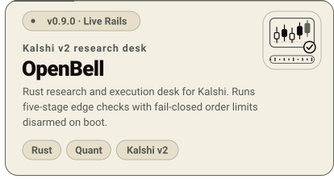
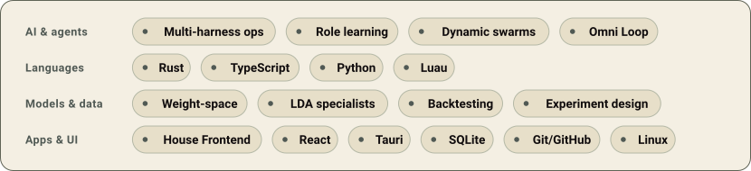

<picture><source media="(max-width: 600px) and (prefers-color-scheme: dark)" srcset="assets/header-m-dark.svg"><source media="(max-width: 600px)" srcset="assets/header-m-light.svg"><source media="(prefers-color-scheme: dark)" srcset="assets/header-dark.svg"></picture>

AI agent systems engineer and technical founder. I have spent the past year on agentic systems and harness engineering, starting while I was finishing high school, where I was also wrestling team captain for two years. For most of that stretch I worked 13 to 14 hours a day on it, around school, my job and wrestling. I work across several harnesses instead of just one: OpenCode and DeepSeek Harness, Claude Desktop and Claude Code, Gemini Antigravity, and ChatGPT Codex — picking whichever fits the job and has capacity. My flagship cross-platform single-binary Rust desktop and web apps (Linux, macOS, and Windows <code>.exe</code> with chromeless desktop launch) are built on one shared House Frontend system (Geist + Geist Mono, calm nested hairline surfaces, Cmd+K navigation, light and dark themes inside Settings): <b>OpenRO</b> (<code>v0.10.0</code>) is a <b>RoPilot-grade 3-pane Roblox Studio AI IDE</b> with <code>Agent | Plan | Ask</code> modes and reviewable unified Luau diffs, directly embedded live Roblox Studio + auto-synced Explorer, the <code>OpenRoCompanion.lua</code> Studio plugin, all 13 official MCP tools, Co-Building Studio 3D, Rojo Ship Pack (<code>.zip</code>) + <code>.rbxlx</code> XML, an 8-pack Tool &amp; Skill Library, Market Taste Craft Radar, and Blender/WAV synthesis; <b>OpenBell</b> (<code>v0.8.0</code>) is a live-connected Kalshi Trade API v2 trading and quant desk behind fail-closed Hard Risk Rails (disarmed by default on every boot), an Emergency Kill Switch, Out-of-Sample Strategy Tournament, PAV isotonic calibration, and a $500/day capital scaling planner; and <b>Fleet</b> (<code>v0.8.0</code>) is parallel mission control for real coding agents (<code>opencode</code>, <code>Claude Code</code>, <code>Codex</code>) with an interactive multi-wave Board / DAG Graph toggle, confirmation-gated PR Preview, Worktree Inspector, Daily Dispatch Budget guardrails, autonomous Auto-Heal, and Playbooks — alongside <b>Ergon</b> (<code>v0.7.0</code>), a personal AI agent desk for every employee with a background cadence scheduler, automatic <code>.history/</code> version diff &amp; restore, tamper-evident Field-Book audit bundles, 3-company switcher, and 12 built-in workflows. Interactive résumé, OpenMotion walkthroughs &amp; live browser apps: <a href="https://cayleb-james2008.github.io/">cayleb-james2008.github.io</a>.

<picture><source media="(max-width: 600px) and (prefers-color-scheme: dark)" srcset="assets/now-m-dark.svg"><source media="(max-width: 600px)" srcset="assets/now-m-light.svg"><source media="(prefers-color-scheme: dark)" srcset="assets/now-dark.svg"></picture>

<h3><picture><source media="(max-width: 600px) and (prefers-color-scheme: dark)" srcset="assets/section-1-m-dark.svg"><source media="(max-width: 600px)" srcset="assets/section-1-m-light.svg"><source media="(prefers-color-scheme: dark)" srcset="assets/section-1-dark.svg"></picture></h3>

<picture><source media="(max-width: 600px) and (prefers-color-scheme: dark)" srcset="assets/work-roblox-m-dark.svg"><source media="(max-width: 600px)" srcset="assets/work-roblox-m-light.svg"><source media="(prefers-color-scheme: dark)" srcset="assets/work-roblox-dark.svg"></picture><picture><source media="(max-width: 600px) and (prefers-color-scheme: dark)" srcset="assets/work-openbell-m-dark.svg"><source media="(max-width: 600px)" srcset="assets/work-openbell-m-light.svg"><source media="(prefers-color-scheme: dark)" srcset="assets/work-openbell-dark.svg"></picture><picture><source media="(max-width: 600px) and (prefers-color-scheme: dark)" srcset="assets/work-fleet-m-dark.svg"><source media="(max-width: 600px)" srcset="assets/work-fleet-m-light.svg"><source media="(prefers-color-scheme: dark)" srcset="assets/work-fleet-dark.svg"></picture><picture><source media="(max-width: 600px) and (prefers-color-scheme: dark)" srcset="assets/work-ergon-m-dark.svg"><source media="(max-width: 600px)" srcset="assets/work-ergon-m-light.svg"><source media="(prefers-color-scheme: dark)" srcset="assets/work-ergon-dark.svg"></picture>

### OpenRO — RoPilot 3-pane Roblox Studio AI IDE (`v0.10.0`)

**Code:** [github.com/cayleb-james2008/open-ro](https://github.com/cayleb-james2008/open-ro) · **Releases:** [Linux / macOS / Windows `.exe`](https://github.com/cayleb-james2008/open-ro/releases/tag/v0.10.0) · **Product page:** [cayleb-james2008.github.io/projects/openro.html](https://cayleb-james2008.github.io/projects/openro.html) · **Live web app:** [cayleb-james2008.github.io/demos/open-ro/](https://cayleb-james2008.github.io/demos/open-ro/)

- Cross-platform single-binary Rust desktop and web app (`v0.10.0`, chromeless `--app` launch): unobstructed **3-pane RoPilot Studio IDE** (`Explorer/Chats` left dock, `Embedded Studio | Studio 3D | Code & Diff | Playable Stage` center workspace + collapsible `Output Console | Agent Trace | Studio MCP Tools (13) | Properties` bottom drawer, and `Agent | Plan | Ask` Copilot right pane with custom `write_luau` / `multi_edit`, staged proposals, and reviewable green/red unified Luau diffs), **Directly Embedded Live Roblox Studio** + transparent official Studio MCP translation, zero-error **`OpenRoCompanion.lua` Studio plugin** (256-bit `0600` token), **8-Pack Tool & Skill Library**, **Market Taste Craft Radar**, headless **Blender 3D `.obj`** + pure-Rust **PCM16 `.wav`** synthesis, and **Rojo Ship Pack (`.zip`)** + bidirectional `.rbxlx` XML (plus standalone reference under `examples/untitled-anime-card-game/`).
- **Live Embedded Studio Auto-Sync & Full Test Matrix (`180/180` Rust tests, `0` clippy / Windows `xwin` errors, `sloplint 0 FAIL`):** Verified live against real Vinegar + `roblox-studio-mcp` + 12 FPS MJPEG streaming inside OpenRO: Explorer auto-synced **268 live Studio items** (`232` Workspace + `21` ReplicatedStorage + scripts) with **0 Luau errors**, `0` console errors, and clean Stop teardown.
- Scale-audited on a **500-instance / 50-script Place + 10 simultaneous Dual-SSE streams** under 30 concurrent clients (Rojo `.zip` `2.44 ms` p95 at `4,908 req/s`, Luau check `4.09 ms` p95 at `7,483 req/s`, plugin status `5.20 ms` p95, MJPEG `5.78 ms` p95, `52.71 MB` peak RSS, **`80/80`** adversarial raw-TCP/HTTP security fuzz vectors blocked cleanly).

### OpenBell — live-connected Kalshi v2 trading & quant desk (`v0.8.0`)

**Code:** [github.com/cayleb-james2008/openbell](https://github.com/cayleb-james2008/openbell) · **Releases:** [Linux / macOS / Windows `.exe` + walkthrough video](https://github.com/cayleb-james2008/openbell/releases/tag/v0.8.0) · **Product page:** [cayleb-james2008.github.io/projects/openbell.html](https://cayleb-james2008.github.io/projects/openbell.html) · **Live web sandbox:** [cayleb-james2008.github.io/demos/openbell/](https://cayleb-james2008.github.io/demos/openbell/)

- Cross-platform single-binary Rust trading and quant research desktop app (`v0.8.0`, chromeless `--app` launch): **Live Connected Kalshi Trade API v2** (RSA-PSS SHA-256 request signing, `0600` key storage, Demo & Production venues) strictly gated behind **Fail-Closed Hard Risk Rails** (`live_armed: false` on every boot/restart, explicit `confirm_arm`, per-order contract/dollar caps, daily loss cap, open-exposure cap, ticker-prefix allowlist, loopback + `X-OpenBell-CSRF` enforcement) and a one-click **Emergency Kill Switch** (`disarm + cancel_all`), verified mechanically by `.loop/checks/rails.sh` (`RAILS OK`) and `.loop/checks/equity.sh` (`EQUITY OK`).
- Full quantitative research workbench alongside the live rails: Out-of-Sample **Strategy Tournament** + `12×12` Correlation & `5×4` Regime Heatmaps, **PAV Isotonic Recalibration** (60% IS / 40% OOS, Wilson CIs, Brier/ECE), **`$500/Day` Capital Scaling & Liquidity Capacity Engine** (1,000-path Monte Carlo compounding + 5-gate scorecard), 4-slot paper compounding desk, and toggleable Auto-Collector (`Off` / `60s` / `180s`). The browser sandbox runs 100% client-side offline on synthetic 15m data with zero real keys or private trading data.
- Scale-audited on **100,000 tape ticks across 2,000 settled 15m windows** under 30 concurrent clients + 5 SSE subscribers (`3.50 ms` live p95, `4.49 ms` tournament p95 at `9,354 req/s`, `211.83 MB` peak RSS, `104/104` Rust tests, `0` clippy / Windows errors, `48/48` security & risk-rail fuzz checks pass).

### Fleet — parallel mission control for coding agents (`v0.8.0`)

**Code:** [github.com/cayleb-james2008/fleet](https://github.com/cayleb-james2008/fleet) · **Releases:** [Linux / macOS / Windows `.exe`](https://github.com/cayleb-james2008/fleet/releases/tag/v0.8.0) · **Product page:** [cayleb-james2008.github.io/projects/fleet.html](https://cayleb-james2008.github.io/projects/fleet.html) · **Live web app:** [cayleb-james2008.github.io/demos/fleet/](https://cayleb-james2008.github.io/demos/fleet/)

- Cross-platform single-binary Rust desktop and web app (`v0.8.0`, native Windows engine + chromeless `--app` launch): interactive multi-wave **`Board` / `DAG Graph` toggle**, **PR Preview & confirmation-gated GitHub PR creator**, **Worktrees Inspector** with safe non-main orphan pruning, **Daily Dispatch Budget guardrails** (`429` on cap), **Autonomous Auto-Heal** (ANSI-stripped stderr steering with SHA-256 identical-error loop guard), reusable **Playbook Templates**, and live **Board Telemetry**.
- **Cold Live CLI Campaign (`42/42 PASS`, `116/116` Rust tests, `.loop/verify 23/23`, `0` clippy / Windows `xwin` errors):** Executed against real `opencode` CLI (zero shims) — proving parallel Wave 1, Wave 2 `depends_on` auto-launch, interactive DAG graph, PR Preview payloads, safe worktree pruning, daily budget enforcement, Auto-Heal recovery, and clean squash merges.
- Scale-audited on **2,000 sessions, 50,000 transcript lines, and 1,000-node DAGs** under 30 concurrent clients + 5 SSE subscribers (`16.04 ms` max p95, `/api/worktrees` `267.8 ms → 16.0 ms` at `6,848 req/s`, `45.20 MB` peak RSS, `27/27` security fuzz checks pass).

### Ergon — an AI agent for every employee (`v0.7.0`)

**Code:** [github.com/cayleb-james2008/ergon](https://github.com/cayleb-james2008/ergon) · **Releases:** [Linux / macOS / Windows `.exe`](https://github.com/cayleb-james2008/ergon/releases/tag/v0.7.0) · **Product page:** [cayleb-james2008.github.io/projects/ergon.html](https://cayleb-james2008.github.io/projects/ergon.html) · **Live web app:** [cayleb-james2008.github.io/demos/ergon/](https://cayleb-james2008.github.io/demos/ergon/)

- Cross-platform single-binary Rust desktop and web app (`v0.7.0`, chromeless `--app` launch): background **cadence routine scheduler** (`Pause/Resume`, UTC wall-clock `daily 09:00` / `hourly`, Run History), automatic **`.history/` file version history** with unified diff & one-click `Restore version`, **tamper-evident Field-Book Audit Bundle export**, 3-company workspace switcher, 12 built-in workflows, live SSE run streaming, Global `Cmd+K`, and SHA-256 receipts.
- **3-Company Live Local-LLM Campaign (`118/118 cold PASS`, `144/144` Rust tests, `0` clippy / Windows `xwin` errors):** Proven end to end on live local Ollama (zero stubs) across **Northstar Cold-Chain Freight**, **Cedarbrook Specialty Dental Group**, and **Ironwood Commercial Mechanical** (`EC-01..EC-09`), proving live cadence pulse writes, diff restore, audit verification, and zero cross-tenant leaks across all 6 ordered tenant pairs.
- Scale-audited on **5,000 receipts and 500 workspace files** under 30 concurrent clients + 5 SSE subscribers (`GET /api/files/history` `13.53 ms` p95 at `2,706 req/s`, `GET /api/search` `102.93 ms` p95, `54.93 MB` peak RSS, `42/42` security fuzz vectors blocked cleanly). In development; not yet installed at a customer company.

<h3><picture><source media="(max-width: 600px) and (prefers-color-scheme: dark)" srcset="assets/section-2-m-dark.svg"><source media="(max-width: 600px)" srcset="assets/section-2-m-light.svg"><source media="(prefers-color-scheme: dark)" srcset="assets/section-2-dark.svg"></picture></h3>

Active public repositories — the four cross-platform single-binary Rust desktop &amp; web apps (v0.7.0–v0.10.0), Sophos, and the interactive résumé site + live multi-document <a href="https://cayleb-james2008.github.io/lab/">/lab/</a> audit workbench (archived earlier work: <a href="https://github.com/cayleb-james2008/dotz">dotz</a> and <a href="https://github.com/cayleb-james2008/industry-ai-suite">industry-ai-suite</a>).

<a href="https://github.com/cayleb-james2008/open-ro"><picture><source media="(max-width: 600px) and (prefers-color-scheme: dark)" srcset="assets/generated/repo-open-ro-m-dark.svg"><source media="(max-width: 600px)" srcset="assets/generated/repo-open-ro-m-light.svg"><source media="(prefers-color-scheme: dark)" srcset="assets/generated/repo-open-ro-dark.svg"></picture></a><a href="https://github.com/cayleb-james2008/openbell"><picture><source media="(max-width: 600px) and (prefers-color-scheme: dark)" srcset="assets/generated/repo-openbell-m-dark.svg"><source media="(max-width: 600px)" srcset="assets/generated/repo-openbell-m-light.svg"><source media="(prefers-color-scheme: dark)" srcset="assets/generated/repo-openbell-dark.svg"></picture></a><a href="https://github.com/cayleb-james2008/fleet"><picture><source media="(max-width: 600px) and (prefers-color-scheme: dark)" srcset="assets/generated/repo-fleet-m-dark.svg"><source media="(max-width: 600px)" srcset="assets/generated/repo-fleet-m-light.svg"><source media="(prefers-color-scheme: dark)" srcset="assets/generated/repo-fleet-dark.svg"></picture></a><a href="https://github.com/cayleb-james2008/ergon"><picture><source media="(max-width: 600px) and (prefers-color-scheme: dark)" srcset="assets/generated/repo-ergon-m-dark.svg"><source media="(max-width: 600px)" srcset="assets/generated/repo-ergon-m-light.svg"><source media="(prefers-color-scheme: dark)" srcset="assets/generated/repo-ergon-dark.svg"></picture></a><a href="https://github.com/cayleb-james2008/sophos"><picture><source media="(max-width: 600px) and (prefers-color-scheme: dark)" srcset="assets/generated/repo-sophos-m-dark.svg"><source media="(max-width: 600px)" srcset="assets/generated/repo-sophos-m-light.svg"><source media="(prefers-color-scheme: dark)" srcset="assets/generated/repo-sophos-dark.svg"></picture></a><a href="https://github.com/cayleb-james2008/cayleb-james2008.github.io"><picture><source media="(max-width: 600px) and (prefers-color-scheme: dark)" srcset="assets/generated/repo-cayleb-james2008.github.io-m-dark.svg"><source media="(max-width: 600px)" srcset="assets/generated/repo-cayleb-james2008.github.io-m-light.svg"><source media="(prefers-color-scheme: dark)" srcset="assets/generated/repo-cayleb-james2008.github.io-dark.svg"></picture></a>

<h3><picture><source media="(max-width: 600px) and (prefers-color-scheme: dark)" srcset="assets/section-3-m-dark.svg"><source media="(max-width: 600px)" srcset="assets/section-3-m-light.svg"><source media="(prefers-color-scheme: dark)" srcset="assets/section-3-dark.svg"></picture></h3>

<picture><source media="(max-width: 600px) and (prefers-color-scheme: dark)" srcset="assets/generated/stats-m-dark.svg"><source media="(max-width: 600px)" srcset="assets/generated/stats-m-light.svg"><source media="(prefers-color-scheme: dark)" srcset="assets/generated/stats-dark.svg"></picture><picture><source media="(max-width: 600px) and (prefers-color-scheme: dark)" srcset="assets/generated/streak-m-dark.svg"><source media="(max-width: 600px)" srcset="assets/generated/streak-m-light.svg"><source media="(prefers-color-scheme: dark)" srcset="assets/generated/streak-dark.svg"></picture>

<picture><source media="(max-width: 600px) and (prefers-color-scheme: dark)" srcset="assets/generated/contrib3d-m-dark.svg"><source media="(max-width: 600px)" srcset="assets/generated/contrib3d-m-light.svg"><source media="(prefers-color-scheme: dark)" srcset="assets/generated/contrib3d-dark.svg"></picture>

One tower per day; heights are on a square-root scale so a few very busy days do not hide the rest. Drawn by scripts in this repo and regenerated daily by a GitHub Action.

Figures in text
<!--numbers:start-->1,649 contributions in the last 12 months (2025-11-23 to 2026-11-22): 1,369 commits, 269 pull requests, 65 active days. Busiest day 398, on 2026-06-24. Current streak 6 days; longest streak 17 days (2026-06-18 to 2026-07-04).<!--numbers:end-->

<h3><picture><source media="(max-width: 600px) and (prefers-color-scheme: dark)" srcset="assets/section-4-m-dark.svg"><source media="(max-width: 600px)" srcset="assets/section-4-m-light.svg"><source media="(prefers-color-scheme: dark)" srcset="assets/section-4-dark.svg"></picture></h3>

<picture><source media="(max-width: 600px) and (prefers-color-scheme: dark)" srcset="assets/stack-m-dark.svg"><source media="(max-width: 600px)" srcset="assets/stack-m-light.svg"><source media="(prefers-color-scheme: dark)" srcset="assets/stack-dark.svg"></picture>

<picture><source media="(max-width: 600px) and (prefers-color-scheme: dark)" srcset="assets/footer-m-dark.svg"><source media="(max-width: 600px)" srcset="assets/footer-m-light.svg"><source media="(prefers-color-scheme: dark)" srcset="assets/footer-dark.svg"></picture>

<a href="https://www.youtube.com/@cayleb-james"><picture><source media="(prefers-color-scheme: dark)" srcset="assets/link-youtube-dark.svg"></picture></a>&nbsp;&nbsp;<a href="https://www.instagram.com/cayleb.james/"><picture><source media="(prefers-color-scheme: dark)" srcset="assets/link-instagram-dark.svg"></picture></a>

Sophos builds on Prime Intellect's open-source Prime Agent (PrimeIntellect-ai/prime-agent, MIT). dotz bundles vendored Open Design content (Apache-2.0). OpenRO, OpenBell, Fleet and Ergon ship as standalone cross-platform single-binary Rust desktop and web apps on the shared House Frontend system, each in its own public repository linked above.

