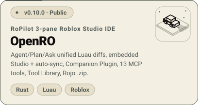

<picture><source media="(max-width: 600px) and (prefers-color-scheme: dark)" srcset="assets/header-m-dark.svg"><source media="(max-width: 600px)" srcset="assets/header-m-light.svg"><source media="(prefers-color-scheme: dark)" srcset="assets/header-dark.svg"></picture>

AI agent systems engineer and technical founder. I have spent the past year on agentic systems and harness engineering, starting while I was finishing high school, where I was also wrestling team captain for two years. For most of that stretch I worked 13 to 14 hours a day on it, around school, my job and wrestling. I work across several harnesses instead of just one: OpenCode and DeepSeek Harness, Claude Desktop and Claude Code, Gemini Antigravity, and ChatGPT Codex — picking whichever fits the job and has capacity. Four single-binary Rust desktop and web apps make up my current releases, built on one shared House Frontend system (Geist + Geist Mono, calm nested hairline surfaces, Cmd+K navigation, light and dark themes inside Settings). <b>Ergon</b> gives every employee a personal AI agent desk with 12 built-in workflows, live SSE run streaming, indexed 5,000-receipt search, standing routines, and SHA-256 receipts. <b>Fleet</b> is parallel mission control for real coding agents (<code>opencode</code>, <code>Claude Code</code>, <code>Codex</code>) in isolated git worktrees with DAG dependencies, multi-step check pipelines, file-scope guardrails, and side-by-side split diffs. <b>OpenRO</b> is a game builder workbench for Roblox Studio with 22 game systems, a Static Luau Prover, a 60fps playable stage, bidirectional <code>.rbxlx</code> XML import/export, and versioned snapshots. <b>OpenBell</b> is a paper-only Kalshi 15-minute quant research desk — collecting live public market data 24/7 with 12 paper strategies, an interactive Strategy Sandbox backtester, and a Calibration/Monte Carlo/Walk-Forward Quant Lab; it places no orders, and no order-placement code path exists. Interactive résumé &amp; live browser apps: <a href="https://cayleb-james2008.github.io/">cayleb-james2008.github.io</a>.

<picture><source media="(max-width: 600px) and (prefers-color-scheme: dark)" srcset="assets/now-m-dark.svg"><source media="(max-width: 600px)" srcset="assets/now-m-light.svg"><source media="(prefers-color-scheme: dark)" srcset="assets/now-dark.svg"></picture>

<h3><picture><source media="(max-width: 600px) and (prefers-color-scheme: dark)" srcset="assets/section-1-m-dark.svg"><source media="(max-width: 600px)" srcset="assets/section-1-m-light.svg"><source media="(prefers-color-scheme: dark)" srcset="assets/section-1-dark.svg"></picture></h3>

<picture><source media="(max-width: 600px) and (prefers-color-scheme: dark)" srcset="assets/work-ergon-m-dark.svg"><source media="(max-width: 600px)" srcset="assets/work-ergon-m-light.svg"><source media="(prefers-color-scheme: dark)" srcset="assets/work-ergon-dark.svg"></picture><picture><source media="(max-width: 600px) and (prefers-color-scheme: dark)" srcset="assets/work-dsh-fleet-m-dark.svg"><source media="(max-width: 600px)" srcset="assets/work-dsh-fleet-m-light.svg"><source media="(prefers-color-scheme: dark)" srcset="assets/work-dsh-fleet-dark.svg"></picture><picture><source media="(max-width: 600px) and (prefers-color-scheme: dark)" srcset="assets/work-roblox-m-dark.svg"><source media="(max-width: 600px)" srcset="assets/work-roblox-m-light.svg"><source media="(prefers-color-scheme: dark)" srcset="assets/work-roblox-dark.svg"></picture><picture><source media="(max-width: 600px) and (prefers-color-scheme: dark)" srcset="assets/work-openbell-m-dark.svg"><source media="(max-width: 600px)" srcset="assets/work-openbell-m-light.svg"><source media="(prefers-color-scheme: dark)" srcset="assets/work-openbell-dark.svg"></picture>

### Ergon — an AI agent for every employee (`v0.5.0`)

**Code:** [github.com/cayleb-james2008/ergon](https://github.com/cayleb-james2008/ergon) · **Product page:** [cayleb-james2008.github.io/projects/ergon.html](https://cayleb-james2008.github.io/projects/ergon.html) · **Live web app:** [cayleb-james2008.github.io/demos/ergon/](https://cayleb-james2008.github.io/demos/ergon/)

- Single-binary Rust desktop and web app (`v0.5.0`): 12 built-in workflows (ledger reconciliation, meeting summaries, contract audit, inbox triage, dataset cleaning, document diffs, briefs, table extraction), live SSE run streaming with cancellation, standing recurring routines, Global `Cmd+K` navigation, and SHA-256 Field-Book receipt export.
- Personal to each employee — isolated workspace, standing memory, threads, and role-tailored workflows. Finishes real file work end to end while parking destructive deletions in Today's approval queue until signed off.
- Scale-audited on **5,000 receipts and 500 workspace files** under 30 concurrent clients + 5 SSE subscribers (`GET /api/search` `8.87 ms` p95 at 5,354 req/s, `51.6 MB` peak RSS, `28/28` path-traversal/symlink escape vectors blocked cleanly). In development; not yet installed at a customer company.

### Fleet — parallel mission control for coding agents (`v0.5.0`)

**Code:** [github.com/cayleb-james2008/dsh-fleet](https://github.com/cayleb-james2008/dsh-fleet) · **Product page:** [cayleb-james2008.github.io/projects/dsh-fleet.html](https://cayleb-james2008.github.io/projects/dsh-fleet.html) · **Live web app:** [cayleb-james2008.github.io/demos/dsh-fleet/](https://cayleb-james2008.github.io/demos/dsh-fleet/)

- Single-binary Rust desktop and web app (`v0.5.0`): real repository discovery (`/api/repos`) and live non-interactive dispatch for `opencode`, `Claude Code`, and `Codex` in isolated git worktrees with DAG dependency scheduling (`depends_on`), batch fan-out, configurable concurrency caps, and live SSE event streaming.
- Done requires a verified receipt: Fleet enforces allowed/forbidden file-scope guardrails, runs timed multi-step check pipelines on a pristine checkout of the committed tree, dry-runs merge conflicts (`/api/sessions/:id/merge-check`), and exposes unified/side-by-side split diffs, `.patch` export, 50k-line virtualized transcripts, and automated Policy Tester rules.
- Sessions survive hard restarts; merges guard against dirty trees and conflicts; POSIX process-group cancellation stops runaway agents cleanly.
- Scale-audited on **2,000 sessions, 50,000 transcript lines, and 1,000-node DAGs** under 30 concurrent clients + 5 SSE subscribers (`GET /api/sessions` `21.30 ms` p95, `GET /api/repos` `10.21 ms` p95 at 3,907 req/s, 1,000-node DAG/cycle validation `4.05 ms`/`3.91 ms`, `58.2 MB` peak RSS, `21/21` policy fuzz checks pass).

### OpenRO — game builder workbench for Roblox Studio (`v0.5.1`)

**Code:** [github.com/cayleb-james2008/open-ro](https://github.com/cayleb-james2008/open-ro) · **Product page:** [cayleb-james2008.github.io/projects/openro.html](https://cayleb-james2008.github.io/projects/openro.html) · **Live web app:** [cayleb-james2008.github.io/demos/open-ro/](https://cayleb-james2008.github.io/demos/open-ro/)

- Single-binary Rust desktop and web app (`v0.5.1`): 22 verified Roblox game systems across Movement, Economy, Combat, World, Persistence, and UI; a Static Luau Prover; a 60fps `WASD`/Space Playable Stage (`Top-Down` / `Side-View`); bidirectional Studio `.rbxlx` XML import/export; inline property editing; versioned Place snapshots; live SSE build streaming; and Studio MCP auto-detection.
- Scale-audited on a **500-instance / 50-Luau-script Place** under 30 concurrent clients + 5 SSE subscribers (`GET /api/export/rbxlx` `3.42 ms`, `GET /api/luau/check` `43.15 ms` p95 at 806 req/s, `53.0 MB` peak RSS, `16/16` malformed/XXE XML fuzz vectors rejected cleanly).

### OpenBell — paper-only Kalshi 15-minute quant desk (`v0.5.0`)

**Code:** [github.com/cayleb-james2008/openbell](https://github.com/cayleb-james2008/openbell)

- Single-binary Rust quant research workbench (`v0.5.0`): collects live public Kalshi 15-minute crypto market data around the clock onto disk with live SSE tape streaming, a 12-strategy library + interactive Strategy Sandbox backtester, 4-slot paper compounding desk with drawdown underwater curves, and a **Quant Lab** (Calibration reliability with 95% Wilson intervals + Brier/ECE, 1,000-path Monte Carlo bootstrap fan chart, and Walk-Forward IS/OOS diagnostics).
- Scale-audited on **100,000 tape ticks across 2,000 settled 15m windows** under 30 concurrent clients + 5 SSE subscribers (`GET /api/home` `3.59 ms` p95 at 8,483 req/s, `POST /api/analytics/montecarlo` 1,000 paths `7.19 ms` p95, `168.8 MB` peak RSS, `39/39` invalid-quote/sandbox fuzz checks pass).
- **Paper-only by construction:** OpenBell places no orders; no order-placement code path exists anywhere in the source or compiled binary, enforced mechanically by `.loop/checks/fence.sh` and `.loop/checks/equity.sh` on every build.

<h3><picture><source media="(max-width: 600px) and (prefers-color-scheme: dark)" srcset="assets/section-2-m-dark.svg"><source media="(max-width: 600px)" srcset="assets/section-2-m-light.svg"><source media="(prefers-color-scheme: dark)" srcset="assets/section-2-dark.svg"></picture></h3>

Active public repositories — the four single-binary Rust desktop &amp; web apps, Sophos, and the interactive résumé site + live multi-document <a href="https://cayleb-james2008.github.io/lab/">/lab/</a> audit workbench (archived earlier work: <a href="https://github.com/cayleb-james2008/dotz">dotz</a> and <a href="https://github.com/cayleb-james2008/industry-ai-suite">industry-ai-suite</a>).

<a href="https://github.com/cayleb-james2008/ergon"><picture><source media="(max-width: 600px) and (prefers-color-scheme: dark)" srcset="assets/generated/repo-ergon-m-dark.svg"><source media="(max-width: 600px)" srcset="assets/generated/repo-ergon-m-light.svg"><source media="(prefers-color-scheme: dark)" srcset="assets/generated/repo-ergon-dark.svg"></picture></a><a href="https://github.com/cayleb-james2008/dsh-fleet"><picture><source media="(max-width: 600px) and (prefers-color-scheme: dark)" srcset="assets/generated/repo-dsh-fleet-m-dark.svg"><source media="(max-width: 600px)" srcset="assets/generated/repo-dsh-fleet-m-light.svg"><source media="(prefers-color-scheme: dark)" srcset="assets/generated/repo-dsh-fleet-dark.svg"></picture></a><a href="https://github.com/cayleb-james2008/open-ro"><picture><source media="(max-width: 600px) and (prefers-color-scheme: dark)" srcset="assets/generated/repo-open-ro-m-dark.svg"><source media="(max-width: 600px)" srcset="assets/generated/repo-open-ro-m-light.svg"><source media="(prefers-color-scheme: dark)" srcset="assets/generated/repo-open-ro-dark.svg"></picture></a><a href="https://github.com/cayleb-james2008/openbell"><picture><source media="(max-width: 600px) and (prefers-color-scheme: dark)" srcset="assets/generated/repo-openbell-m-dark.svg"><source media="(max-width: 600px)" srcset="assets/generated/repo-openbell-m-light.svg"><source media="(prefers-color-scheme: dark)" srcset="assets/generated/repo-openbell-dark.svg"></picture></a><a href="https://github.com/cayleb-james2008/sophos"><picture><source media="(max-width: 600px) and (prefers-color-scheme: dark)" srcset="assets/generated/repo-sophos-m-dark.svg"><source media="(max-width: 600px)" srcset="assets/generated/repo-sophos-m-light.svg"><source media="(prefers-color-scheme: dark)" srcset="assets/generated/repo-sophos-dark.svg"></picture></a><a href="https://github.com/cayleb-james2008/cayleb-james2008.github.io"><picture><source media="(max-width: 600px) and (prefers-color-scheme: dark)" srcset="assets/generated/repo-cayleb-james2008.github.io-m-dark.svg"><source media="(max-width: 600px)" srcset="assets/generated/repo-cayleb-james2008.github.io-m-light.svg"><source media="(prefers-color-scheme: dark)" srcset="assets/generated/repo-cayleb-james2008.github.io-dark.svg"></picture></a>

<h3><picture><source media="(max-width: 600px) and (prefers-color-scheme: dark)" srcset="assets/section-3-m-dark.svg"><source media="(max-width: 600px)" srcset="assets/section-3-m-light.svg"><source media="(prefers-color-scheme: dark)" srcset="assets/section-3-dark.svg"></picture></h3>

<picture><source media="(max-width: 600px) and (prefers-color-scheme: dark)" srcset="assets/generated/stats-m-dark.svg"><source media="(max-width: 600px)" srcset="assets/generated/stats-m-light.svg"><source media="(prefers-color-scheme: dark)" srcset="assets/generated/stats-dark.svg"></picture><picture><source media="(max-width: 600px) and (prefers-color-scheme: dark)" srcset="assets/generated/streak-m-dark.svg"><source media="(max-width: 600px)" srcset="assets/generated/streak-m-light.svg"><source media="(prefers-color-scheme: dark)" srcset="assets/generated/streak-dark.svg"></picture>

<picture><source media="(max-width: 600px) and (prefers-color-scheme: dark)" srcset="assets/generated/contrib3d-m-dark.svg"><source media="(max-width: 600px)" srcset="assets/generated/contrib3d-m-light.svg"><source media="(prefers-color-scheme: dark)" srcset="assets/generated/contrib3d-dark.svg"></picture>

One tower per day; heights are on a square-root scale so a few very busy days do not hide the rest. Drawn by scripts in this repo and regenerated daily by a GitHub Action.

Figures in text
<!--numbers:start-->1,649 contributions in the last 12 months (2025-11-23 to 2026-11-22): 1,369 commits, 269 pull requests, 65 active days. Busiest day 398, on 2026-06-24. Current streak 6 days; longest streak 17 days (2026-06-18 to 2026-07-04).<!--numbers:end-->

<h3><picture><source media="(max-width: 600px) and (prefers-color-scheme: dark)" srcset="assets/section-4-m-dark.svg"><source media="(max-width: 600px)" srcset="assets/section-4-m-light.svg"><source media="(prefers-color-scheme: dark)" srcset="assets/section-4-dark.svg"></picture></h3>

<picture><source media="(max-width: 600px) and (prefers-color-scheme: dark)" srcset="assets/stack-m-dark.svg"><source media="(max-width: 600px)" srcset="assets/stack-m-light.svg"><source media="(prefers-color-scheme: dark)" srcset="assets/stack-dark.svg"></picture>

<picture><source media="(max-width: 600px) and (prefers-color-scheme: dark)" srcset="assets/footer-m-dark.svg"><source media="(max-width: 600px)" srcset="assets/footer-m-light.svg"><source media="(prefers-color-scheme: dark)" srcset="assets/footer-dark.svg"></picture>

<a href="https://www.youtube.com/@cayleb-james"><picture><source media="(prefers-color-scheme: dark)" srcset="assets/link-youtube-dark.svg"></picture></a>&nbsp;&nbsp;<a href="https://www.instagram.com/cayleb.james/"><picture><source media="(prefers-color-scheme: dark)" srcset="assets/link-instagram-dark.svg"></picture></a>

Sophos builds on Prime Intellect's open-source Prime Agent (PrimeIntellect-ai/prime-agent, MIT). dotz bundles vendored Open Design content (Apache-2.0). Ergon, Fleet, OpenRO and OpenBell ship as standalone single-binary Rust desktop and web apps on the shared House Frontend system, each in its own public repository linked above.

