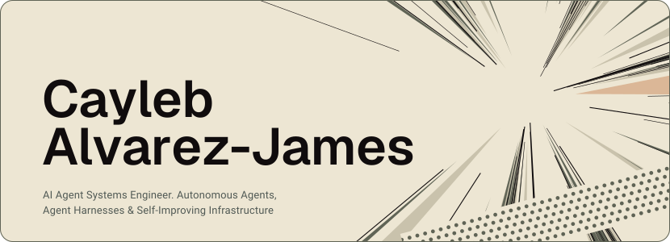

<picture><source media="(max-width: 600px) and (prefers-color-scheme: dark)" srcset="assets/header-m-dark.svg"><source media="(max-width: 600px)" srcset="assets/header-m-light.svg"><source media="(prefers-color-scheme: dark)" srcset="assets/header-dark.svg"></picture>

AI agent systems engineer and technical founder. I have spent the past year on agentic systems and harness engineering, starting while I was finishing high school, where I was also wrestling team captain for two years. For most of that stretch I worked 13 to 14 hours a day on it, around school, my job and wrestling. I work across several harnesses instead of just one: OpenCode and DeepSeek Harness, Claude Desktop and Claude Code, Gemini Antigravity, and ChatGPT Codex — picking whichever fits the job and has capacity. Four single-binary Rust desktop and web apps make up my current releases, built on one shared House Frontend system (Geist + Geist Mono, calm nested hairline surfaces, Cmd+K navigation, light and dark themes inside Settings). <b>Ergon</b> (<code>v0.6.0</code>) gives every employee a personal AI agent desk with 12 built-in workflows, live SSE streaming, indexed 5,000-receipt search, SHA-256 receipts, and 96/96 3-company live local-LLM E2E hardening. <b>Fleet</b> (<code>v0.6.0</code>) is parallel mission control for real coding agents (<code>opencode</code>, <code>Claude Code</code>, <code>Codex</code>) with an autonomous Auto-Heal feedback loop, reusable Playbook templates, live Board Telemetry, DAG dependencies, and file-scope guardrails. <b>OpenRO</b> (<code>v0.7.0</code>) is a game builder workbench for Roblox Studio featuring an embedded realtime <b>Roblox Studio 3D Viewport</b> (orbit/pan/zoom, 3D gizmos, Agent Builder Drone &amp; Replay Build, Live Studio MCP Feed), 28 game systems, Card Art Studio, playable <i>Anime Card Battles: Rebirth — Apex Edition</i>, and bidirectional <code>.rbxlx</code> XML. <b>OpenBell</b> (<code>v0.6.0</code>) is a paper-only Kalshi 15-minute quant research desk — live public market data + top-of-book depth, PAV isotonic recalibration, and a $500/day paper capital scaling planner with an honest 5-gate scorecard; it places no orders, and no order-placement code path exists. Interactive résumé &amp; live browser apps: <a href="https://cayleb-james2008.github.io/">cayleb-james2008.github.io</a>.

<picture><source media="(max-width: 600px) and (prefers-color-scheme: dark)" srcset="assets/now-m-dark.svg"><source media="(max-width: 600px)" srcset="assets/now-m-light.svg"><source media="(prefers-color-scheme: dark)" srcset="assets/now-dark.svg"></picture>

<h3><picture><source media="(max-width: 600px) and (prefers-color-scheme: dark)" srcset="assets/section-1-m-dark.svg"><source media="(max-width: 600px)" srcset="assets/section-1-m-light.svg"><source media="(prefers-color-scheme: dark)" srcset="assets/section-1-dark.svg"></picture></h3>

<picture><source media="(max-width: 600px) and (prefers-color-scheme: dark)" srcset="assets/work-ergon-m-dark.svg"><source media="(max-width: 600px)" srcset="assets/work-ergon-m-light.svg"><source media="(prefers-color-scheme: dark)" srcset="assets/work-ergon-dark.svg"></picture><picture><source media="(max-width: 600px) and (prefers-color-scheme: dark)" srcset="assets/work-dsh-fleet-m-dark.svg"><source media="(max-width: 600px)" srcset="assets/work-dsh-fleet-m-light.svg"><source media="(prefers-color-scheme: dark)" srcset="assets/work-dsh-fleet-dark.svg"></picture><picture><source media="(max-width: 600px) and (prefers-color-scheme: dark)" srcset="assets/work-roblox-m-dark.svg"><source media="(max-width: 600px)" srcset="assets/work-roblox-m-light.svg"><source media="(prefers-color-scheme: dark)" srcset="assets/work-roblox-dark.svg"></picture><picture><source media="(max-width: 600px) and (prefers-color-scheme: dark)" srcset="assets/work-openbell-m-dark.svg"><source media="(max-width: 600px)" srcset="assets/work-openbell-m-light.svg"><source media="(prefers-color-scheme: dark)" srcset="assets/work-openbell-dark.svg"></picture>

### Ergon — an AI agent for every employee (`v0.6.0`)

**Code:** [github.com/cayleb-james2008/ergon](https://github.com/cayleb-james2008/ergon) · **Product page:** [cayleb-james2008.github.io/projects/ergon.html](https://cayleb-james2008.github.io/projects/ergon.html) · **Live web app:** [cayleb-james2008.github.io/demos/ergon/](https://cayleb-james2008.github.io/demos/ergon/)

- Single-binary Rust desktop and web app (`v0.6.0`): 12 built-in workflows (ledger reconciliation, meeting summaries, contract audit, inbox triage, dataset cleaning with accounting-negative `($12.34)` support, document diffs, briefs, table extraction), live SSE run streaming with cancellation, standing recurring routines, zero host-path leakage on missing files, Global `Cmd+K` navigation, and SHA-256 Field-Book receipt export.
- **3-Company Live Local-LLM Torture Campaign (`96/96 PASS`):** Proven end to end on live local Ollama (zero stubs) across 3 distinct fictional companies — **Northstar Cold-Chain Freight** (`$44,903.27` penny-exact ledger & duplicate BOL), **Cedarbrook Specialty Dental Group** (`$31,099.37` claims & 15-day auto-renewal audit), and **Ironwood Commercial Mechanical** (`$125,434.90` ragged BOM CSV & `$94,500` chiller outlier) — proving all 8 edge cases (`EC-01..EC-08`) and zero cross-tenant leaks across all 6 ordered tenant pairs on one server.
- Scale-audited on **5,000 receipts and 500 workspace files** under 30 concurrent clients + 5 SSE subscribers (`GET /api/search` `10.28 ms–12.48 ms` p95 at 4,309 req/s, `GET /api/receipts` `6.04 ms` p95 at 5,724 req/s, `47.8 MB` peak RSS, `28/28` path-traversal/symlink escape vectors blocked cleanly). In development; not yet installed at a customer company.

### Fleet — parallel mission control for coding agents (`v0.6.0`)

**Code:** [github.com/cayleb-james2008/dsh-fleet](https://github.com/cayleb-james2008/dsh-fleet) · **Product page:** [cayleb-james2008.github.io/projects/dsh-fleet.html](https://cayleb-james2008.github.io/projects/dsh-fleet.html) · **Live web app:** [cayleb-james2008.github.io/demos/dsh-fleet/](https://cayleb-james2008.github.io/demos/dsh-fleet/)

- Single-binary Rust desktop and web app (`v0.6.0`): real repository discovery (`/api/repos`) and live non-interactive dispatch for `opencode`, `Claude Code`, and `Codex` in isolated git worktrees with **Autonomous Auto-Heal** (deterministic ANSI-stripped stderr steering via `--continue` up to `auto_steer_budget` with a SHA-256 identical-error loop guard that never bypasses file-scope guardrails), **Reusable Playbook Templates** (`/api/templates` + `Cmd+K`), **Live Board Telemetry** (`/api/metrics`), and DAG dependency scheduling (`depends_on`).
- **3-Repo Multi-Wave Live CLI Campaign (`35/35 PASS`):** Executed in 52s against real `opencode` CLI (zero shims) across `py-ledger-api`, `node-cli-tools`, and `sh-ops-kit` — proving parallel Wave 1, real autonomous Auto-Heal fixing a failing `SCHEMA_MISMATCH` check in 14.5s into verified `done`, Wave 2 `depends_on` auto-launch, file-scope guardrail refusal in `Needs you`, pre-merge conflict detection, and 3 clean squash merges.
- Scale-audited on **2,000 sessions, 50,000 transcript lines, and 1,000-node DAGs** under 30 concurrent clients + 5 SSE subscribers (`GET /api/metrics` `4.54 ms` p95 at 6,891 req/s, `GET /api/templates` `5.09 ms` p95 at 6,343 req/s, `GET /api/sessions` `16.61 ms` p95, `54.2 MB` peak RSS, `22/22` policy & template traversal fuzz checks pass).

### OpenRO — realtime 3D Roblox Studio workbench (`v0.7.0`)

**Code:** [github.com/cayleb-james2008/open-ro](https://github.com/cayleb-james2008/open-ro) · **Product page:** [cayleb-james2008.github.io/projects/openro.html](https://cayleb-james2008.github.io/projects/openro.html) · **Live web app:** [cayleb-james2008.github.io/demos/open-ro/](https://cayleb-james2008.github.io/demos/open-ro/)

- Single-binary Rust desktop and web app (`v0.7.0`): **Embedded Realtime Roblox Studio 3D Viewport** (zero-dependency Canvas 3D perspective renderer with stud baseplate, 3D Axis ViewCube, perspective-mapped 3D Card Billboards, interactive Select/Move/Scale/Rotate gizmos, Follow Agent camera, animated Agent Builder Drone & Laser Beam, step-by-step `Replay Build`, and docked Live Agent Stream console) + **Live Studio MCP PNG Frame Feed** (`/api/studio/frame` + `/api/studio/stream`), alongside **28 verified Roblox game systems**, **Card Art Studio** + **Anime Homage Style Guide**, playable **Anime Card Battles: Rebirth — Apex Edition**, Static Luau Prover, and bidirectional Studio `.rbxlx` XML.
- **Dual Live E2E & End-to-End Game Build (`20/20` local + `4/4` MCP + `143/143` Rust tests):** Proved live 3D Agent Stream + Move gizmo persistence + Replay Build + real MCP `screen_capture` PNG streaming (`320×200`) into `Studio Feed`, plus `examples/anime-card-battles-apex/AnimeCardBattlesApex.rbxlx` (`85.6 KB`, `58` items, `12` scripts, `8` Decals, `8` ImageLabels, `59,073` Luau chars, `0` Luau errors).
- Scale-audited on a **500-instance / 50-script Place + 500-event ring + 10 simultaneous Dual-SSE streams** under 30 concurrent clients (`GET /api/studio/frame` `8.57 ms` p95 at 4,684 req/s, `GET /api/studio/actions` `5.15 ms` p95 at 6,487 req/s, `GET /api/luau/check` `31.08 ms` p95, `43/43` XML/asset/studio security fuzz vectors blocked cleanly).

### OpenBell — paper-only Kalshi 15-minute quant desk (`v0.6.0`)

**Code:** [github.com/cayleb-james2008/openbell](https://github.com/cayleb-james2008/openbell)

- Single-binary Rust quant research workbench (`v0.6.0`): collects live public Kalshi 15-minute crypto market data + top-of-book depth (`yes_bid_size`/`no_bid_size`) around the clock onto disk with live SSE tape streaming, a 12-strategy library + interactive Strategy Sandbox backtester, 4-slot paper compounding desk, **PAV Isotonic Recalibration** (`/api/analytics/recalibration`, strictly fitted on chronological 60% IS and evaluated on 40% OOS with 95% Wilson CIs, Brier/ECE, and EV-after-fees entry gate), and the **`$500/Day` Paper Capital Scaling & Liquidity Capacity Engine** (`/api/analytics/scale-plan`, 1,000-path 180-day Monte Carlo compounding, equal-slot / Quarter-Kelly / Half-Kelly bankroll sizing, empirical vs sensitivity separation, and an honest 5-gate `PAPER_RESEARCH_ONLY` readiness scorecard).
- Scale-audited on **100,000 tape ticks across 2,000 settled 15m windows** under 30 concurrent clients + 5 SSE subscribers (`POST /api/analytics/scale-plan` 1,000 paths `28.55 ms` p95 at 975 req/s, `GET /api/analytics/recalibration` `7.06 ms` p95 at 4,548 req/s, `GET /api/home` `8.40 ms` p95, `227.6 MB` peak RSS, `32/32` quote/sandbox/scale-plan fuzz checks pass).
- **Paper-only by construction:** OpenBell places no orders; no order-placement code path exists anywhere in the source or compiled binary, enforced mechanically by `.loop/checks/fence.sh` (`FENCE OK`) and `.loop/checks/equity.sh` (`EQUITY OK`) on every build.

<h3><picture><source media="(max-width: 600px) and (prefers-color-scheme: dark)" srcset="assets/section-2-m-dark.svg"><source media="(max-width: 600px)" srcset="assets/section-2-m-light.svg"><source media="(prefers-color-scheme: dark)" srcset="assets/section-2-dark.svg"></picture></h3>

Active public repositories — the four single-binary Rust desktop &amp; web apps (v0.6.0–v0.7.0), Sophos, and the interactive résumé site + live multi-document <a href="https://cayleb-james2008.github.io/lab/">/lab/</a> audit workbench (archived earlier work: <a href="https://github.com/cayleb-james2008/dotz">dotz</a> and <a href="https://github.com/cayleb-james2008/industry-ai-suite">industry-ai-suite</a>).

<a href="https://github.com/cayleb-james2008/ergon"><picture><source media="(max-width: 600px) and (prefers-color-scheme: dark)" srcset="assets/generated/repo-ergon-m-dark.svg"><source media="(max-width: 600px)" srcset="assets/generated/repo-ergon-m-light.svg"><source media="(prefers-color-scheme: dark)" srcset="assets/generated/repo-ergon-dark.svg"></picture></a><a href="https://github.com/cayleb-james2008/dsh-fleet"><picture><source media="(max-width: 600px) and (prefers-color-scheme: dark)" srcset="assets/generated/repo-dsh-fleet-m-dark.svg"><source media="(max-width: 600px)" srcset="assets/generated/repo-dsh-fleet-m-light.svg"><source media="(prefers-color-scheme: dark)" srcset="assets/generated/repo-dsh-fleet-dark.svg"></picture></a><a href="https://github.com/cayleb-james2008/open-ro"><picture><source media="(max-width: 600px) and (prefers-color-scheme: dark)" srcset="assets/generated/repo-open-ro-m-dark.svg"><source media="(max-width: 600px)" srcset="assets/generated/repo-open-ro-m-light.svg"><source media="(prefers-color-scheme: dark)" srcset="assets/generated/repo-open-ro-dark.svg"></picture></a><a href="https://github.com/cayleb-james2008/openbell"><picture><source media="(max-width: 600px) and (prefers-color-scheme: dark)" srcset="assets/generated/repo-openbell-m-dark.svg"><source media="(max-width: 600px)" srcset="assets/generated/repo-openbell-m-light.svg"><source media="(prefers-color-scheme: dark)" srcset="assets/generated/repo-openbell-dark.svg"></picture></a><a href="https://github.com/cayleb-james2008/sophos"><picture><source media="(max-width: 600px) and (prefers-color-scheme: dark)" srcset="assets/generated/repo-sophos-m-dark.svg"><source media="(max-width: 600px)" srcset="assets/generated/repo-sophos-m-light.svg"><source media="(prefers-color-scheme: dark)" srcset="assets/generated/repo-sophos-dark.svg"></picture></a><a href="https://github.com/cayleb-james2008/cayleb-james2008.github.io"><picture><source media="(max-width: 600px) and (prefers-color-scheme: dark)" srcset="assets/generated/repo-cayleb-james2008.github.io-m-dark.svg"><source media="(max-width: 600px)" srcset="assets/generated/repo-cayleb-james2008.github.io-m-light.svg"><source media="(prefers-color-scheme: dark)" srcset="assets/generated/repo-cayleb-james2008.github.io-dark.svg"></picture></a>

<h3><picture><source media="(max-width: 600px) and (prefers-color-scheme: dark)" srcset="assets/section-3-m-dark.svg"><source media="(max-width: 600px)" srcset="assets/section-3-m-light.svg"><source media="(prefers-color-scheme: dark)" srcset="assets/section-3-dark.svg"></picture></h3>

<picture><source media="(max-width: 600px) and (prefers-color-scheme: dark)" srcset="assets/generated/stats-m-dark.svg"><source media="(max-width: 600px)" srcset="assets/generated/stats-m-light.svg"><source media="(prefers-color-scheme: dark)" srcset="assets/generated/stats-dark.svg"></picture><picture><source media="(max-width: 600px) and (prefers-color-scheme: dark)" srcset="assets/generated/streak-m-dark.svg"><source media="(max-width: 600px)" srcset="assets/generated/streak-m-light.svg"><source media="(prefers-color-scheme: dark)" srcset="assets/generated/streak-dark.svg"></picture>

<picture><source media="(max-width: 600px) and (prefers-color-scheme: dark)" srcset="assets/generated/contrib3d-m-dark.svg"><source media="(max-width: 600px)" srcset="assets/generated/contrib3d-m-light.svg"><source media="(prefers-color-scheme: dark)" srcset="assets/generated/contrib3d-dark.svg"></picture>

One tower per day; heights are on a square-root scale so a few very busy days do not hide the rest. Drawn by scripts in this repo and regenerated daily by a GitHub Action.

Figures in text
<!--numbers:start-->1,649 contributions in the last 12 months (2025-11-23 to 2026-11-22): 1,369 commits, 269 pull requests, 65 active days. Busiest day 398, on 2026-06-24. Current streak 6 days; longest streak 17 days (2026-06-18 to 2026-07-04).<!--numbers:end-->

<h3><picture><source media="(max-width: 600px) and (prefers-color-scheme: dark)" srcset="assets/section-4-m-dark.svg"><source media="(max-width: 600px)" srcset="assets/section-4-m-light.svg"><source media="(prefers-color-scheme: dark)" srcset="assets/section-4-dark.svg"></picture></h3>

<picture><source media="(max-width: 600px) and (prefers-color-scheme: dark)" srcset="assets/stack-m-dark.svg"><source media="(max-width: 600px)" srcset="assets/stack-m-light.svg"><source media="(prefers-color-scheme: dark)" srcset="assets/stack-dark.svg"></picture>

<picture><source media="(max-width: 600px) and (prefers-color-scheme: dark)" srcset="assets/footer-m-dark.svg"><source media="(max-width: 600px)" srcset="assets/footer-m-light.svg"><source media="(prefers-color-scheme: dark)" srcset="assets/footer-dark.svg"></picture>

<a href="https://www.youtube.com/@cayleb-james"><picture><source media="(prefers-color-scheme: dark)" srcset="assets/link-youtube-dark.svg"></picture></a>&nbsp;&nbsp;<a href="https://www.instagram.com/cayleb.james/"><picture><source media="(prefers-color-scheme: dark)" srcset="assets/link-instagram-dark.svg"></picture></a>

Sophos builds on Prime Intellect's open-source Prime Agent (PrimeIntellect-ai/prime-agent, MIT). dotz bundles vendored Open Design content (Apache-2.0). Ergon, Fleet, OpenRO and OpenBell ship as standalone single-binary Rust desktop and web apps on the shared House Frontend system, each in its own public repository linked above.

