<picture><source media="(max-width: 600px) and (prefers-color-scheme: dark)" srcset="assets/header-m-dark.svg"><source media="(max-width: 600px)" srcset="assets/header-m-light.svg"><source media="(prefers-color-scheme: dark)" srcset="assets/header-dark.svg"></picture>

<!-- FROZEN-COPY-START: owner-approved, see COPY-RULES.md. scripts/copy_guard.py fails if this block changes. -->
<h3><picture><source media="(max-width: 600px) and (prefers-color-scheme: dark)" srcset="assets/section-1-m-dark.svg"><source media="(max-width: 600px)" srcset="assets/section-1-m-light.svg"><source media="(prefers-color-scheme: dark)" srcset="assets/section-1-dark.svg"></picture></h3>

**What's one thing about me worth remembering?**

I turn repetitive work into something that runs itself.

**What number am I proudest of?**

4,000 tests check every change for me and hold every gate in place.

**What does Ergon do for someone at work?**

Ergon adapts. It learns each employee's workflow and the tools they already use, then turns them into Ergon-native tools that every agent on Ergon can use.

**Who did I picture using Ergon?**

An older employee, picture a grandpa with a monocle, sees a microphone button, talks to his agent, and watches it take over his computer and use all his apps. No technical effort, nothing to set up.

**How do I build?**

I'm not an expert in every field, and one agent loses track as its context fills up. So I split the work across agents that each take a role with its own skills, spun up and run by an orchestrator. I hand it a plain goal, sometimes just a voice transcript, and building ambitious products in any field stops being limited by what I know.

**What should you look at first?**

[Ergon](https://github.com/cayleb-james2008/ergon).

**Which skills could I explain to an interviewer for five minutes?**

- Self-improving agent loops: systems that review and improve how they work and how they build.
- Agents that learn a person's role: early, in Ergon. Personal memory, a skill library, and cards the employee clicks.
- Weight-space model editing: research. Using a large model to edit a small model's weights for a task.

<h3><picture><source media="(max-width: 600px) and (prefers-color-scheme: dark)" srcset="assets/section-2-m-dark.svg"><source media="(max-width: 600px)" srcset="assets/section-2-m-light.svg"><source media="(prefers-color-scheme: dark)" srcset="assets/section-2-dark.svg"></picture></h3>

**Ergon.** Learns each employee's workflow and tools, then turns them into tools every agent on Ergon can use. It is still in development and has not been installed at a customer company. [Source](https://github.com/cayleb-james2008/ergon) · [Project page](https://cayleb-james2008.github.io/projects/ergon.html) · [Typed preview in your browser](https://cayleb-james2008.github.io/demos/ergon/) (no voice, no backend)

**OpenRO** · [Source](https://github.com/cayleb-james2008/open-ro)

**Fleet** · [Source](https://github.com/cayleb-james2008/fleet)

**OpenBell** · [Source](https://github.com/cayleb-james2008/openbell)

My résumé site: [cayleb-james2008.github.io](https://cayleb-james2008.github.io/)

<!-- FROZEN-COPY-END -->

<h3><picture><source media="(max-width: 600px) and (prefers-color-scheme: dark)" srcset="assets/section-3-m-dark.svg"><source media="(max-width: 600px)" srcset="assets/section-3-m-light.svg"><source media="(prefers-color-scheme: dark)" srcset="assets/section-3-dark.svg"></picture></h3>

<picture><source media="(max-width: 600px) and (prefers-color-scheme: dark)" srcset="assets/generated/contrib3d-m-dark.svg"><source media="(max-width: 600px)" srcset="assets/generated/contrib3d-m-light.svg"><source media="(prefers-color-scheme: dark)" srcset="assets/generated/contrib3d-dark.svg"></picture>

<!--numbers:start-->1,813 contributions in the last 12 months (2025-11-23 to 2026-11-27): 1,755 commits, 52 pull requests, 20 active days. Busiest day 367, on 2026-11-18. Current streak 12 days; longest streak 12 days (2026-11-16 to 2026-11-27).<!--numbers:end-->

<h3><picture><source media="(max-width: 600px) and (prefers-color-scheme: dark)" srcset="assets/section-4-m-dark.svg"><source media="(max-width: 600px)" srcset="assets/section-4-m-light.svg"><source media="(prefers-color-scheme: dark)" srcset="assets/section-4-dark.svg"></picture></h3>

<picture><source media="(max-width: 600px) and (prefers-color-scheme: dark)" srcset="assets/stack-m-dark.svg"><source media="(max-width: 600px)" srcset="assets/stack-m-light.svg"><source media="(prefers-color-scheme: dark)" srcset="assets/stack-dark.svg"></picture>

<a href="https://www.youtube.com/@cayleb-james"><picture><source media="(prefers-color-scheme: dark)" srcset="assets/link-youtube-dark.svg"></picture></a>&nbsp;&nbsp;<a href="https://www.instagram.com/cayleb.james/"><picture><source media="(prefers-color-scheme: dark)" srcset="assets/link-instagram-dark.svg"></picture></a>

