<picture><source media="(max-width: 600px) and (prefers-color-scheme: dark)" srcset="assets/header-m-dark.svg"><source media="(max-width: 600px)" srcset="assets/header-m-light.svg"><source media="(prefers-color-scheme: dark)" srcset="assets/header-dark.svg"></picture>

Im 18 and based in Connecticut, where I just finished high school after two years as wrestling captain and now work a full-time job. Over the past year I spent 13 to 14 hours a day around school, wrestling, and work learning how to build local software for autonomous agents.

Instead of locking myself into one provider, I switch between OpenCode, Claude Desktop, Claude Code, Gemini Antigravity, and ChatGPT Codex depending on the task. Right now I am focused on three active projects (OpenRO for Roblox Studio games, Fleet for Antigravity agent swarms, and Ergon for local employee workflows) alongside OpenBell <code>v0.9.0</code>. My interactive resume and browser sandboxes live at <a href="https://cayleb-james2008.github.io/">cayleb-james2008.github.io</a>.

<picture><source media="(max-width: 600px) and (prefers-color-scheme: dark)" srcset="assets/now-m-dark.svg"><source media="(max-width: 600px)" srcset="assets/now-m-light.svg"><source media="(prefers-color-scheme: dark)" srcset="assets/now-dark.svg"></picture>

<h3><picture><source media="(max-width: 600px) and (prefers-color-scheme: dark)" srcset="assets/section-1-m-dark.svg"><source media="(max-width: 600px)" srcset="assets/section-1-m-light.svg"><source media="(prefers-color-scheme: dark)" srcset="assets/section-1-dark.svg"></picture></h3>

<picture><source media="(max-width: 600px) and (prefers-color-scheme: dark)" srcset="assets/work-roblox-m-dark.svg"><source media="(max-width: 600px)" srcset="assets/work-roblox-m-light.svg"><source media="(prefers-color-scheme: dark)" srcset="assets/work-roblox-dark.svg"></picture><picture><source media="(max-width: 600px) and (prefers-color-scheme: dark)" srcset="assets/work-openbell-m-dark.svg"><source media="(max-width: 600px)" srcset="assets/work-openbell-m-light.svg"><source media="(prefers-color-scheme: dark)" srcset="assets/work-openbell-dark.svg"></picture><picture><source media="(max-width: 600px) and (prefers-color-scheme: dark)" srcset="assets/work-fleet-m-dark.svg"><source media="(max-width: 600px)" srcset="assets/work-fleet-m-light.svg"><source media="(prefers-color-scheme: dark)" srcset="assets/work-fleet-dark.svg"></picture><picture><source media="(max-width: 600px) and (prefers-color-scheme: dark)" srcset="assets/work-ergon-m-dark.svg"><source media="(max-width: 600px)" srcset="assets/work-ergon-m-light.svg"><source media="(prefers-color-scheme: dark)" srcset="assets/work-ergon-dark.svg"></picture>

### OpenRO (`v1.16.0`)

[Source](https://github.com/cayleb-james2008/open-ro) · [Release v1.16.0](https://github.com/cayleb-james2008/open-ro/releases/tag/v1.16.0) · [Project page](https://cayleb-james2008.github.io/projects/openro.html) · [Browser sandbox](https://cayleb-james2008.github.io/demos/open-ro/)

OpenRO is a three-pane Rust IDE built for generating and debugging Roblox Studio games. It connects to live Studio via `OpenRoCompanion.lua` and 13 official MCP tools, runs pre-publish asset and Luau readiness checks with one-click safe autofixes, resolves Rojo live-sync conflicts, and exports clean `.rbxlx` files or Rojo `.zip` packs. Release `v1.16.0` passes 314 Rust tests, 56 Playwright UI checks, and 39 raw-TCP security fuzz checks in a 9.06 MB binary (`13.86 MB` peak RSS, `6,144.5 req/s`).

### OpenBell (`v0.9.0`)

[Source](https://github.com/cayleb-james2008/openbell) · [Release v0.9.0](https://github.com/cayleb-james2008/openbell/releases/tag/v0.9.0) · [Project page](https://cayleb-james2008.github.io/projects/openbell.html) · [Offline sandbox](https://cayleb-james2008.github.io/demos/openbell/)

OpenBell is a Rust research and trading terminal for the Kalshi v2 API. It runs chronological backtests with lookahead guards, strategy tournaments, and isotonic probability calibration, and starts with live order execution disarmed by default behind explicit caps and a kill switch. The browser sandbox runs on synthetic 15-minute market data with zero real credentials.

### Fleet (`v1.15.0`)

[Source](https://github.com/cayleb-james2008/fleet) · [Release v1.15.0](https://github.com/cayleb-james2008/fleet/releases/tag/v1.15.0) · [Project page](https://cayleb-james2008.github.io/projects/fleet.html) · [Live preview](https://cayleb-james2008.github.io/demos/fleet/)

Fleet runs inside Antigravity as a sidebar plugin that tracks multi-agent message boards, worker status, wave velocity, token burn, and confined git worktree diffs in real time. Release `v1.15.0` adds one-click stalled and idle worker recovery alongside member-filtered Board jumps directly from Triage and Roster. All 11 sidecar tests, 46 Playwright UI checks, and 30 security fuzz checks pass, while keeping `--jitless` RSS at 69.41 MB (`1,168.8 req/s`).

### Ergon (`v0.25.0`)

[Source](https://github.com/cayleb-james2008/ergon) · [Release v0.25.0](https://github.com/cayleb-james2008/ergon/releases/tag/v0.25.0) · [Project page](https://cayleb-james2008.github.io/projects/ergon.html) · [Browser app](https://cayleb-james2008.github.io/demos/ergon/)

Ergon is a single-binary Rust desktop and web desk for running local employee workflows inside a sandboxed folder with `.history/` file restore, SHA-256 receipts, and workspace audit policy profiles (`Fast Internal`, `Strict Client`, and `Air-Gapped`). Release `v0.25.0` fits in an 8.38 MB binary (`16.15 MB` peak RSS) and passes 223 Rust tests, 74 Playwright UI checks, and 36 raw-TCP fuzz checks; it is still in development and not yet installed at a company.

<h3><picture><source media="(max-width: 600px) and (prefers-color-scheme: dark)" srcset="assets/section-2-m-dark.svg"><source media="(max-width: 600px)" srcset="assets/section-2-m-light.svg"><source media="(prefers-color-scheme: dark)" srcset="assets/section-2-dark.svg"></picture></h3>

Active repositories for OpenRO (v1.16.0), OpenBell (v0.9.0), Fleet (v1.15.0), Ergon (v0.25.0), Sophos, and the <a href="https://cayleb-james2008.github.io/lab/">/lab/</a> multi-document workbench (earlier archived repos: <a href="https://github.com/cayleb-james2008/dotz">dotz</a> and <a href="https://github.com/cayleb-james2008/industry-ai-suite">industry-ai-suite</a>).

<a href="https://github.com/cayleb-james2008/open-ro"><picture><source media="(max-width: 600px) and (prefers-color-scheme: dark)" srcset="assets/generated/repo-open-ro-m-dark.svg"><source media="(max-width: 600px)" srcset="assets/generated/repo-open-ro-m-light.svg"><source media="(prefers-color-scheme: dark)" srcset="assets/generated/repo-open-ro-dark.svg"></picture></a><a href="https://github.com/cayleb-james2008/openbell"><picture><source media="(max-width: 600px) and (prefers-color-scheme: dark)" srcset="assets/generated/repo-openbell-m-dark.svg"><source media="(max-width: 600px)" srcset="assets/generated/repo-openbell-m-light.svg"><source media="(prefers-color-scheme: dark)" srcset="assets/generated/repo-openbell-dark.svg"></picture></a><a href="https://github.com/cayleb-james2008/fleet"><picture><source media="(max-width: 600px) and (prefers-color-scheme: dark)" srcset="assets/generated/repo-fleet-m-dark.svg"><source media="(max-width: 600px)" srcset="assets/generated/repo-fleet-m-light.svg"><source media="(prefers-color-scheme: dark)" srcset="assets/generated/repo-fleet-dark.svg"></picture></a><a href="https://github.com/cayleb-james2008/ergon"><picture><source media="(max-width: 600px) and (prefers-color-scheme: dark)" srcset="assets/generated/repo-ergon-m-dark.svg"><source media="(max-width: 600px)" srcset="assets/generated/repo-ergon-m-light.svg"><source media="(prefers-color-scheme: dark)" srcset="assets/generated/repo-ergon-dark.svg"></picture></a><a href="https://github.com/cayleb-james2008/sophos"><picture><source media="(max-width: 600px) and (prefers-color-scheme: dark)" srcset="assets/generated/repo-sophos-m-dark.svg"><source media="(max-width: 600px)" srcset="assets/generated/repo-sophos-m-light.svg"><source media="(prefers-color-scheme: dark)" srcset="assets/generated/repo-sophos-dark.svg"></picture></a><a href="https://github.com/cayleb-james2008/cayleb-james2008.github.io"><picture><source media="(max-width: 600px) and (prefers-color-scheme: dark)" srcset="assets/generated/repo-cayleb-james2008.github.io-m-dark.svg"><source media="(max-width: 600px)" srcset="assets/generated/repo-cayleb-james2008.github.io-m-light.svg"><source media="(prefers-color-scheme: dark)" srcset="assets/generated/repo-cayleb-james2008.github.io-dark.svg"></picture></a>

<h3><picture><source media="(max-width: 600px) and (prefers-color-scheme: dark)" srcset="assets/section-3-m-dark.svg"><source media="(max-width: 600px)" srcset="assets/section-3-m-light.svg"><source media="(prefers-color-scheme: dark)" srcset="assets/section-3-dark.svg"></picture></h3>

<picture><source media="(max-width: 600px) and (prefers-color-scheme: dark)" srcset="assets/generated/stats-m-dark.svg"><source media="(max-width: 600px)" srcset="assets/generated/stats-m-light.svg"><source media="(prefers-color-scheme: dark)" srcset="assets/generated/stats-dark.svg"></picture><picture><source media="(max-width: 600px) and (prefers-color-scheme: dark)" srcset="assets/generated/streak-m-dark.svg"><source media="(max-width: 600px)" srcset="assets/generated/streak-m-light.svg"><source media="(prefers-color-scheme: dark)" srcset="assets/generated/streak-dark.svg"></picture>

<picture><source media="(max-width: 600px) and (prefers-color-scheme: dark)" srcset="assets/generated/contrib3d-m-dark.svg"><source media="(max-width: 600px)" srcset="assets/generated/contrib3d-m-light.svg"><source media="(prefers-color-scheme: dark)" srcset="assets/generated/contrib3d-dark.svg"></picture>

One tower per day; heights use a square-root scale so busy days do not hide the rest. Generated daily by scripts in this repo.

Figures in text
<!--numbers:start-->2,710 contributions in the last 12 months (2025-11-23 to 2026-11-26): 2,428 commits, 271 pull requests, 71 active days. Busiest day 452, on 2026-11-18. Current streak 10 days; longest streak 17 days (2026-06-18 to 2026-07-04).<!--numbers:end-->

<h3><picture><source media="(max-width: 600px) and (prefers-color-scheme: dark)" srcset="assets/section-4-m-dark.svg"><source media="(max-width: 600px)" srcset="assets/section-4-m-light.svg"><source media="(prefers-color-scheme: dark)" srcset="assets/section-4-dark.svg"></picture></h3>

<picture><source media="(max-width: 600px) and (prefers-color-scheme: dark)" srcset="assets/stack-m-dark.svg"><source media="(max-width: 600px)" srcset="assets/stack-m-light.svg"><source media="(prefers-color-scheme: dark)" srcset="assets/stack-dark.svg"></picture>

<picture><source media="(max-width: 600px) and (prefers-color-scheme: dark)" srcset="assets/footer-m-dark.svg"><source media="(max-width: 600px)" srcset="assets/footer-m-light.svg"><source media="(prefers-color-scheme: dark)" srcset="assets/footer-dark.svg"></picture>

<a href="https://www.youtube.com/@cayleb-james"><picture><source media="(prefers-color-scheme: dark)" srcset="assets/link-youtube-dark.svg"></picture></a>&nbsp;&nbsp;<a href="https://www.instagram.com/cayleb.james/"><picture><source media="(prefers-color-scheme: dark)" srcset="assets/link-instagram-dark.svg"></picture></a>

Sophos builds on Prime Intellect's open-source Prime Agent (PrimeIntellect-ai/prime-agent, MIT). dotz bundles vendored Open Design content (Apache-2.0). OpenRO, OpenBell, and Ergon ship as cross-platform single-binary Rust desktop and web apps, and Fleet runs as an Antigravity sidebar plugin.

